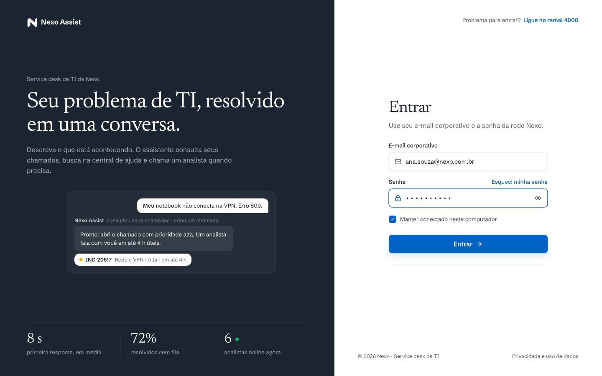
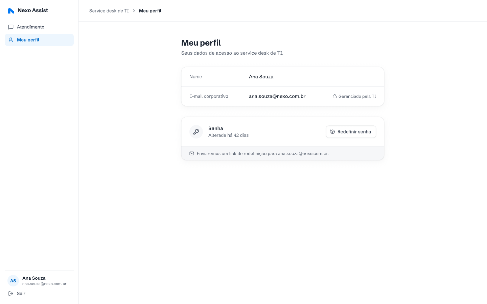

# Acesso: login, papéis e Meu perfil

**Approved**: 2026-10-28 - user: "Aprovo todas as recomendações Q-01 a Q-16"

Tamanho: Medium · Fonte: PDF (O que construir 1) + protótipo (Telas 01 e 06) · Status: Specify aprovado em 2026-10-28

## Problem Statement

O funcionário entra com o e-mail corporativo e o analista entra para usar o console. O PDF pede login com e-mail e senha que aceite os funcionários do seed com qualquer senha. A base vem com cadastro e login reais do Better Auth e com um dashboard de exemplo, que precisam virar o login do protótipo e a separação entre funcionário e analista.

## Goals

- [ ] Tela de login fiel a `01-login.png`, aceitando e-mails do seed com qualquer senha.
- [ ] Papéis funcionário e analista, cada um levado à sua área e barrado na do outro, na tela e na API.
- [ ] Meu perfil (Tela 06) só leitura, pendente de Q-08.

## Out of Scope

| Item | Motivo |
| --- | --- |
| Cadastro de usuário | O PDF só fala em entrar com os funcionários do seed. Sai da base. |
| Senha real, redefinição real e envio de e-mail | "qualquer senha" no PDF; ver Q-07 e Q-08. |
| SSO corporativo | Não citado. |
| Layout mobile | Q-15. |

## Assumptions & Open Questions

| Assumption | Chosen default | Rationale | Confirmed? |
| --- | --- | --- | --- |
| Validação de senha (Q-07) | Qualquer senha não vazia para e-mail do seed. | PDF: "aceitando os funcionários do seed com qualquer senha". Vazia é recusada porque o campo existe na tela. | y - recomendação aprovada (AD-006) |
| E-mail fora do seed (Q-07) | Recusar com "Não encontramos esse e-mail. Use seu e-mail corporativo da Nexo." | Sem cadastro, não há como criar conta. Texto proposto, não está no protótipo. | y - recomendação aprovada (AD-006) |
| Entrada do analista (Q-07) | Mesma tela; papel `analista` vem do seed e leva a `/console`. | O protótipo não tem tela de login de analista. | y - recomendação aprovada (AD-006) |
| "Manter conectado neste computador" | Marcado: sessão de 30 dias. Desmarcado: sessão termina ao fechar o navegador. | Comportamento usual do controle. | y - recomendação aprovada em 2026-10-28 |
| "Esqueci minha senha" e "Redefinir senha" (Q-08) | Mostram confirmação simulada, sem enviar e-mail. | Qualquer senha entra, então não há o que redefinir. | y - recomendação aprovada (AD-006) |
| Vitrine do login (8 s, 72%, 6 analistas, mini chat) (Q-12) | Texto estático, fiel ao protótipo. | Dados ilustrativos (Anexo C). | y - recomendação aprovada (AD-009) |
| "Ligue no ramal 4000" e "Privacidade e uso de dados" (Q-12) | Ramal como texto. Privacidade abre um modal curto dizendo que cada funcionário vê só os próprios chamados. | Sem destino no PDF. | y - recomendação aprovada (AD-009) |
| Tela 06 entra no escopo (Q-08) | Sim, só leitura. "Alterada há 42 dias" vem de um campo do seed. | O protótipo a desenha; o PDF não a cita. | y - recomendação aprovada (AD-006) |

**Open questions:** none - Q-07, Q-08, Q-12, Q-15, Q-16 respondidas em 2026-10-28 ("Aprovo todas as recomendações Q-01 a Q-16"); decisões em `STATE.md` (AD-006, AD-009, AD-011).

## User Stories

### P1: Entrar com o e-mail corporativo ⭐ MVP

**User Story**: Como funcionário, quero entrar com meu e-mail corporativo, para usar o atendimento.

**Why P1**: Tela 1 do PDF; nada funciona sem sessão.

**Acceptance Criteria**:

1. WHEN alguém sem sessão abre qualquer rota THEN o sistema SHALL levar a `/login` e mostrar a tela como `.specs/features/acesso/captures/01-login.png`: vitrine escura à esquerda com "Seu problema de TI, resolvido em uma conversa." e o formulário "Entrar" à direita. [Protótipo] `AUTH-01`
2. The formulário SHALL ter os campos "E-mail corporativo" e "Senha", o link "Esqueci minha senha", a caixa "Manter conectado neste computador" e o botão "Entrar →", com os textos do protótipo. [Protótipo] `AUTH-02`
3. WHEN o funcionário envia um e-mail do seed e uma senha não vazia THEN o sistema SHALL criar a sessão e abrir `/atendimento`. [PDF] `AUTH-03`
4. WHEN o e-mail do seed é de um analista THEN o sistema SHALL criar a sessão e abrir `/console`. [Proposta] `AUTH-04`
5. The sistema SHALL comparar o e-mail sem diferenciar maiúsculas e sem espaços nas pontas. [Proposta] `AUTH-05`
6. IF o e-mail não está no seed THEN o sistema SHALL mostrar "Não encontramos esse e-mail. Use seu e-mail corporativo da Nexo." abaixo do campo, sem criar sessão. [Proposta] `AUTH-06`
7. IF o e-mail está vazio ou fora do formato, ou a senha está vazia THEN o sistema SHALL marcar o campo com a mensagem e não enviar. [Proposta] `AUTH-07`
8. WHILE o login está sendo enviado o sistema SHALL desabilitar "Entrar →" e mostrar um indicador de carregamento no botão. [PDF] `AUTH-08`
9. IF o servidor não responde ou responde erro THEN o sistema SHALL mostrar "Não foi possível entrar agora. Tente de novo." e manter o que foi digitado. [PDF] `AUTH-09`
10. WHEN o funcionário usa o ícone de olho do campo "Senha" THEN o sistema SHALL alternar entre mostrar e esconder a senha. [Protótipo] `AUTH-10`
11. WHERE "Manter conectado neste computador" está marcado o sistema SHALL manter a sessão por 30 dias; desmarcado, a sessão SHALL terminar ao fechar o navegador. [Proposta] `AUTH-11`
12. WHEN o funcionário usa "Esqueci minha senha" THEN o sistema SHALL mostrar "Neste ambiente qualquer senha entra. Em produção, enviaríamos um link para o seu e-mail." sem enviar e-mail. [Proposta] `AUTH-12`
13. The sistema SHALL não oferecer cadastro em nenhuma tela nem na API. [PDF] `AUTH-13`

**Independent Test**: Entrar como ana.souza@nexo.com.br com "x" abre o chat; como rafael.lima@nexo.com.br abre o console; com fulano@gmail.com aparece o erro.

---

### P1: Separar funcionário e analista ⭐ MVP

**User Story**: Como Nexo, quero que cada papel veja só a sua área, para um funcionário nunca abrir o console.

**Why P1**: Segurança e privacidade, "Também esperado".

**Acceptance Criteria**:

1. IF um funcionário abre `/console` THEN o sistema SHALL levá-lo a `/atendimento`; IF um analista abre `/atendimento` THEN o sistema SHALL levá-lo a `/console`. [Proposta] `AUTH-14`
2. IF uma chamada à API chega sem sessão THEN o servidor SHALL responder `UNAUTHORIZED`; IF um funcionário chama um procedimento de analista THEN o servidor SHALL responder `FORBIDDEN`. [PDF] `AUTH-15`
3. WHEN o usuário usa "Sair" THEN o sistema SHALL encerrar a sessão no servidor e abrir `/login`. [Protótipo] `AUTH-16`

**Independent Test**: Chamar o procedimento de listar conversas do console com o cookie da Ana devolve `FORBIDDEN`.

---

### P2: Ver Meu perfil

**User Story**: Como funcionário, quero ver meus dados de acesso.

**Why P2**: Está no protótipo, não no PDF (Q-08).

**Acceptance Criteria**:

1. WHEN o funcionário usa "Meu perfil" na barra lateral THEN o sistema SHALL mostrar a tela como `.specs/features/acesso/captures/06-cliente-meu-perfil.png`, com nome e e-mail da sessão e o selo "Gerenciado pela TI". [Protótipo] `AUTH-17`
2. The barra lateral SHALL mostrar as iniciais, o nome e o e-mail da sessão e destacar o item da página aberta ("Atendimento" ou "Meu perfil"). [Protótipo] `AUTH-18`
3. The linha "Senha" SHALL mostrar "Alterada há N dias", com N calculado do campo do seed. [Protótipo] `AUTH-19`
4. WHEN o funcionário usa "Redefinir senha" THEN o sistema SHALL mostrar "Link enviado para <e-mail>. (Simulado: nenhum e-mail sai deste ambiente.)" sem enviar e-mail. [Proposta] `AUTH-20`

**Independent Test**: Abrir Meu perfil como Ana mostra "ana.souza@nexo.com.br"; "Redefinir senha" mostra a confirmação e nada é enviado.

---

## Edge Cases

- A sessão expira com o chat aberto: a próxima ação leva ao login e, depois de entrar, volta para a mesma rota.
- E-mail com maiúsculas ("Ana.Souza@Nexo.com.br") entra como Ana.
- Usuário já logado que abre `/login` vai direto para a sua área.

## Implicit-Requirement Dimensions

Medium: dimensões presentes nesta feature.

| Dimension | Coverage |
| --- | --- |
| Input validation & bounds | AUTH-05, AUTH-07 |
| Failure / partial-failure states | AUTH-09 |
| Auth boundaries & rate limits | AUTH-13, AUTH-14, AUTH-15 |
| Data lifecycle / expiry | AUTH-11 (duração da sessão) |

Remaining dimensions N/A for this scope.

## Requirement Traceability

| ID | Story | Phase | Status |
| --- | --- | --- | --- |
| AUTH-01 | P1 - Entrar com o e-mail corporativo | Specify | Pending |
| AUTH-02 | P1 - Entrar com o e-mail corporativo | Specify | Pending |
| AUTH-03 | P1 - Entrar com o e-mail corporativo | Specify | Pending |
| AUTH-04 | P1 - Entrar com o e-mail corporativo | Specify | Pending |
| AUTH-05 | P1 - Entrar com o e-mail corporativo | Specify | Pending |
| AUTH-06 | P1 - Entrar com o e-mail corporativo | Specify | Pending |
| AUTH-07 | P1 - Entrar com o e-mail corporativo | Specify | Pending |
| AUTH-08 | P1 - Entrar com o e-mail corporativo | Specify | Pending |
| AUTH-09 | P1 - Entrar com o e-mail corporativo | Specify | Pending |
| AUTH-10 | P1 - Entrar com o e-mail corporativo | Specify | Pending |
| AUTH-11 | P1 - Entrar com o e-mail corporativo | Specify | Pending |
| AUTH-12 | P1 - Entrar com o e-mail corporativo | Specify | Pending |
| AUTH-13 | P1 - Entrar com o e-mail corporativo | Specify | Pending |
| AUTH-14 | P1 - Separar funcionário e analista | Specify | Pending |
| AUTH-15 | P1 - Separar funcionário e analista | Specify | Pending |
| AUTH-16 | P1 - Separar funcionário e analista | Specify | Pending |
| AUTH-17 | P2 - Ver Meu perfil | Specify | Pending |
| AUTH-18 | P2 - Ver Meu perfil | Specify | Pending |
| AUTH-19 | P2 - Ver Meu perfil | Specify | Pending |
| AUTH-20 | P2 - Ver Meu perfil | Specify | Pending |

**Coverage:** 20 critérios, todos mapeados a uma história.

## Sources

 - binding - Tela de login: vitrine escura com mini chat e números, formulário "Entrar", rodapé.

 - binding - Meu perfil: barra lateral, nome, e-mail corporativo gerenciado pela TI, senha e "Redefinir senha". Não está no PDF (Q-08).

- `../../source/desafio-prd.md`: O que construir 1, Também esperado (segurança).
- `../../source/prototipo.md`: textos e tokens (Newsreader, Schibsted Grotesk, IBM Plex Mono; cta #0062C4).

## Differences from the source

| Source shows | Product shows | Confirmed |
| --- | --- | --- |
| "Use seu e-mail corporativo e a senha da rede Nexo." | O mesmo texto; qualquer senha não vazia entra para um e-mail do seed | y - AD-006 |
| "Esqueci minha senha" e "Redefinir senha" | Confirmação simulada, sem envio de e-mail | y - AD-006 |
| Tela 06 "Meu perfil" (não citada no PDF) | Meu perfil só leitura | y - AD-006 |
| Vitrine do login (8 s, 72%, 6 analistas, mini chat), "Ligue no ramal 4000", "Privacidade e uso de dados" | Vitrine estática; ramal como texto; Privacidade abre um modal curto | y - AD-009 |
| Tema claro | Tema claro, sem o alternador de tema da base | y - AD-011 |

## Success Criteria

- [ ] Login e Meu perfil batem com as capturas em 1440x900.
- [ ] Nenhuma rota de analista responde a um funcionário.
