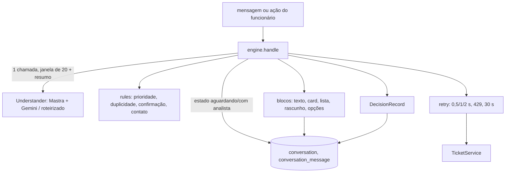

# Agent Design

**Spec**: `.specs/features/agent/spec.md`
**Status**: Approved
**Approved**: 2026-10-28 - user: "sim, faça a aplicação de todas as features, me avise se precisar de algo" (delegado por André em t152u; abordagem A e D-01 a D-04 recomendadas adotadas, AD-020)

---

## Approaches (Complex: confirmar antes de detalhar)

As três cobrem AGT-01 a AGT-47 com Mastra e Gemini (AD-008).

### A. Modelo só entende; o código decide e escreve (recomendada)

Uma chamada estruturada ao modelo por mensagem (`Understanding`: intenção, confiança, campos extraídos, chamado citado, artigo que serve, mesmo problema). Um motor em código (`packages/agent`) aplica o Anexo A: escolhe a ação, chama o `TicketService`, monta rascunho, calcula prioridade, transfere e escreve a resposta a partir de modelos de texto e do retorno das ferramentas.

- **Prós**: AGT-03 vale por construção (o texto ao funcionário nunca vem do modelo); regras de prioridade, prazo, privacidade e estados testadas sem LLM; 1 chamada por mensagem (free tier com 15 req/min); avaliação reproduzível com entendimento roteirizado.
- **Contras**: respostas menos variadas; o README explica a troca.

### B. Agent Mastra com tools e texto livre do modelo

O modelo recebe as tools do serviço e escreve a resposta; o código valida as tools (confirmação, prioridade).

- **Prós**: conversa mais natural, menos código.
- **Contras**: várias chamadas por mensagem; o modelo pode afirmar prazos que não vieram da tool (AGT-03); avaliação depende do modelo; difícil provar "nunca cria sem confirmar" só com testes.

### C. Workflow Mastra com passos por intenção

Cada intenção vira um workflow com passos e suspend/resume para confirmações.

- **Prós**: estados explícitos no Mastra.
- **Contras**: o estado da conversa já precisa morar no D1 (AGT-07, AGT-40); suspend/resume do Mastra duplicaria esse estado e pede storage do Mastra no Worker.

**Recomendação: A** (adotada).

---

## Architecture Overview



## Code Reuse Analysis

### Existing Components to Leverage

| Component | Location | How to Use |
| --- | --- | --- |
| `TicketService`, tipos | `packages/tickets/src/types.ts` | Única porta para chamados e central (AD-013) |
| `rankArticles` | `packages/tickets/src/kb.ts` | Já vem atrás de `searchArticles` |
| `addBusinessMinutes`, `deadlineFor`, `REOPEN_WINDOW_MS` | `packages/tickets/src/rules/*` | Prazo de contato e janela de 7 dias |
| `createTestDb`, `buildSeed`, `applySeed` | `packages/tickets/src/testing`, `seed` | Testes de integração com libsql em memória |
| `profile.os` | `packages/db/src/schema/tickets.ts` | Condição do artigo (AGT-10) |

### Integration Points

| System | Integration Method |
| --- | --- |
| D1 / Drizzle | Tabelas novas `conversation` e `conversation_message` em `packages/db/src/schema/agent.ts`, migração gerada |
| Mastra | `new Agent({ model })` com `structuredOutput` (zod) em `understand-mastra.ts`; modelo de `LLM_MODEL` (padrão `google/gemini-2.5-flash-lite`) |
| `chat-funcionario`, `console-analista` | Usam `createAgent(...).handle/history/returnToAgent`; a rota tRPC fica nessas features |

## Components

### Regras puras (`packages/agent/src/rules/`)

- `priority.ts`: `priorityFor(facts)` e `priorityReason(facts, priority)` (AGT-25, AGT-26). `facts = { type, affected: Affected | "Não sei", blocksWork, sameDayCommitment, workaround }`.
- `contact.ts`: `teamFor(priority, vencido)` e `contactDeadline(priority, now)` (2 h úteis; Crítica 1 h corrida).
- `duplicates.ts`: `duplicateAction(tickets, sameProblemNumber, now)` → `complement | reopen | new_citing | new` (AGT-20 a AGT-22).
- `confirm.ts`: `isTextConfirmation(text)` (AGT-32).
- `summary.ts`: `transferSummary(...)` com problema, tentativas, chamado, prioridade e motivo (AGT-39).

### Chamadas externas (`packages/agent/src/retry.ts`)

- `withTicketRetry(fn, sleep)`: até 3 novas tentativas em `SERVICE_UNAVAILABLE`, esperas 500, 1000, 2000 ms, mesma chave (AGT-43).
- `withModelLimits(fn, { sleep, now })`: 429 espera `retryAfter` (padrão 2 s) e tenta 1 vez; corte em 30 s (AGT-44, AGT-47).

### Entendimento (`understand.ts`, `understand-mastra.ts`, `understand-scripted.ts`)

- `UnderstandingSchema` (zod): `intent`, `confidence` 0-100, `fields` (`title`, `description`, `type`, `category`, `item`, `affected`, `blocksWork`, `sameDayCommitment`, `workaround`), `ticketNumber`, `sameProblemNumber`, `articleSlug`, `articleFits` + `articleMisfitReason`, `outOfScopeArea`, `manipulation`, `noteText`, `summary`.
- `Understander.understand({ window, summary, profile, openTickets, articles })` → `{ understanding, usage }`.
- Mastra: prompt com o Anexo A; `structuredOutput`. Roteirizado: devolve a próxima resposta de uma fila (testes e avaliação).

### Motor (`engine.ts`)

`createAgent({ tickets, understander, store, clock, sleep })` com:

- `handle(conversationId, actor, input)`, `input = { text } | { action: "confirm" | "edit" | "cancel" | "select" | "option" | "retry", value? }` → `AgentTurn { blocks, decision } | { silent: true }`.
- Estados da conversa: `agent`, `aguardando_analista`, `com_analista` (AGT-40, AGT-41). Rascunho pendente: `ticket_draft | update_draft | reopen_draft | transfer_offer`, guardado na conversa.
- Texto ao funcionário só de modelos em `copy.ts` com dados do serviço (AGT-03).

### Armazenamento (`store.ts`)

`ConversationStore` (Drizzle): `open(userId)`, `get(id)`, `append(id, message)`, `setState`, `setPending`, `messages(id)`. Mensagens com `role` (`employee | agent | analyst | system`), `blocks` JSON, `decision` JSON, `tokens`.

### Janela e custo (`window.ts`)

`buildWindow(messages)`: últimas 20 mais o resumo das anteriores (AGT-46); `estimateCost(usage, model)` em US$ com a tabela de preço pago do Flash-Lite (free tier custa 0; registra o equivalente).

### Avaliação (`packages/agent/eval/`)

`conversations.ts` com 22 conversas roteirizadas (mensagem, entendimento roteirizado, esperado: intenção, ação, tipo, categoria, prioridade, regra); `bun run eval` imprime acerto por regra e total. `--live` usa o modelo real (pede `GOOGLE_GENERATIVE_AI_API_KEY`).

## Data Models

```ts
interface DecisionRecord {
  intent: Intent; confidence: number; extracted: Record<string, unknown>;
  action: AgentAction; rule: string; reason: string;
  tools: { name: string; ok: boolean; attempts: number }[];
  usage?: { inputTokens: number; outputTokens: number; costUsd: number };
}
type AgentAction = "responder" | "perguntar" | "responder_artigo" | "mostrar_chamado" | "listar_chamados"
  | "rascunho_chamado" | "rascunho_atualizacao" | "rascunho_reabrir" | "criar_chamado" | "complementar_chamado"
  | "reabrir_chamado" | "transferir" | "redirecionar" | "recusar" | "descartar" | "falha";
```

Tabelas: `conversation(id, user_id, state, pending json, summary, created_at, updated_at)` e `conversation_message(id, conversation_id, seq, role, text, blocks json, decision json, created_at)`.

## Error Handling Strategy

| Error Scenario | Handling | User Impact |
| --- | --- | --- |
| `SERVICE_UNAVAILABLE` | 3 novas tentativas (0,5/1/2 s), mesma chave | Transparente; se persistir, "Não consegui criar o chamado agora" + rascunho mantido + "Tentar de novo" |
| Modelo 429 | Espera `retryAfter` ou 2 s, 1 nova tentativa em 30 s | Mensagem de muitas solicitações; nada criado |
| Modelo erro ou > 30 s | Sem ação | "Não consegui entender agora" + mensagem mantida para tentar de novo |
| `TICKET_CLOSED` na confirmação | Propõe reabrir | Rascunho de reabertura |
| `NOT_FOUND` | Mesma frase para inexistente e alheio | "Não encontrei esse chamado entre os seus." |

## Tech Decisions

| Decision | Choice | Rationale |
| --- | --- | --- |
| D-01 Pacote | `packages/agent`, depende só de tipos de `@nexo-assist/tickets` e do `db` | Separação agent x legado (AD-013) |
| D-02 Modelo | `@mastra/core` 1.80.0 com model router; padrão `google/gemini-2.5-flash-lite` via `LLM_MODEL` | AD-008; Flash-Lite tem a maior cota do free tier |
| D-03 Testes | `Understander` roteirizado; um teste do adaptador Mastra com modelo falso (`MockLanguageModelV3` de `ai/test`) | Nenhum teste chama rede |
| D-04 Abaixo de 60% | Não age e transfere com "Agent pediu ajuda" (AD-007); tipo/categoria abaixo de 60% pergunta (AGT-23) | Spec |

## Risks & Concerns

- Mastra no Worker: `@mastra/core` com `nodejs_compat`; se o bundle quebrar, o adaptador troca para `ai` + `@ai-sdk/google` sem mudar o motor (o motor só vê `Understander`).
- Sem `GOOGLE_GENERATIVE_AI_API_KEY` no ambiente, o modo `--live` da avaliação não roda; a avaliação roteirizada roda sempre.
