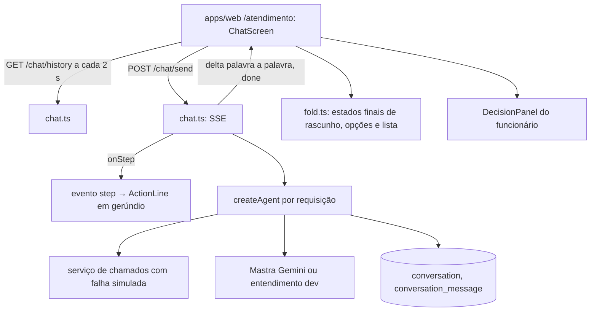

# Chat do funcionário Design

**Spec**: `.specs/features/chat-funcionario/spec.md`
**Status**: Approved
**Approved**: 2026-10-28 - user: "sim, faça a aplicação de todas as features, me avise se precisar de algo" (delegado por André em t152u; abordagem A e D-01 a D-06 recomendadas adotadas, AD-020)

---

## Approaches

### A. Rotas Hono `/chat/*` com SSE + tela que dobra o histórico (recomendada)

O Worker expõe `GET /chat/history`, `POST /chat/send` (resposta em SSE) e `POST /chat/new`. O `send` monta o agent da requisição, repassa cada `onStep` como evento `step`, solta o texto final palavra a palavra como `delta` e fecha com `done` (blocos e registro de decisão). A tela guarda o histórico e "dobra" os blocos: rascunhos e perguntas antigas ficam no estado final.

- **Prós**: SSE é texto sobre HTTP e roda no Worker sem Durable Object; o histórico é a fonte da verdade (CHAT-25); teste do servidor com `app.request()` e do cliente com uma API falsa.
- **Contras**: o texto sai depois da decisão, não token a token do modelo (o modelo só entende; quem escreve é o código, AD-001).

### B. tRPC com subscription

- **Contras**: subscriptions do tRPC precisam de WebSocket ou SSE próprio do adapter; mais camadas para o mesmo resultado.

### C. WebSocket com Durable Object

- **Contras**: recurso novo no Cloudflare só para empurrar mensagens; o histórico com polling de 2 s já cumpre os 3 s do CHAT-28.

**Recomendação: A** (adotada).

---

## Decisions

| ID | Decisão | Por quê |
| --- | --- | --- |
| D-01 | Mastra no Worker (plano A). Prova em 2026-10-28: rota temporária no `alchemy dev` (workerd 1.20261012.1, `nodejs_compat`) montou o `createMastraUnderstander` e chamou o Google; resposta "API key not valid", ou seja, o caminho todo roda. Plano B (`ai` + `@ai-sdk/google`) não foi preciso. | AD-021 |
| D-02 | Streaming em SSE: `step` (início e fim de cada passo), `delta` (uma palavra), `done` (blocos, decisão, contador), `error`. | Spec "Transporte do streaming" |
| D-03 | Limite: conta mensagens do funcionário com texto (texto, opção, seleção). No limite o servidor responde 429; aceita só `{ action: "analyst" }` (transfere com gatilho "pedido") e `POST /chat/new`. | CHAT-22 a CHAT-24, AD-005 |
| D-04 | Conversa encerrada: novo estado `encerrada`; `store.open` ignora encerradas e abre outra (contador zerado). | CHAT-29 |
| D-05 | Analista e linhas de sistema por polling do histórico a cada 2 s; selo de saúde por `GET /` a cada 15 s. | CHAT-09, CHAT-28 |
| D-06 | Sem `GOOGLE_GENERATIVE_AI_API_KEY`: com `DEV_SEED_ENABLED=true` um entendimento por palavras-chave (só dev, para o walk); sem as duas, o entendimento falha e o agent diz que o modelo está indisponível. | Walk sem chave; nada de chave no repositório |

---

## Architecture Overview

## Code Reuse Analysis

| Component | Location | How to Use |
| --- | --- | --- |
| `createAgent`, `ConversationStore` | `packages/agent/src/engine.ts`, `store.ts` | Ganham `close`, `{ action: "analyst" }` e o estado `encerrada` |
| `createTicketService` | `apps/server/src/tickets.ts` | Ator vindo da sessão (TKT-06) |
| `createMastraUnderstander` | `packages/agent/src/understand-mastra.ts` | Com a chave do env |
| `ActionLine`, `DecisionPanel` | `apps/web/src/features/decision` | Linha acima da resposta e painel |
| `EmployeeFrame` | `apps/web/src/features/shell` | Barra lateral e superior (CHAT-01, CHAT-33) |
| `agentHarness` | `packages/agent/src/testing.ts` | Agent dos testes do servidor |

## Components

### Sessão (`packages/agent/src/session.ts`)

- `MESSAGE_LIMIT = 30`, `MAX_CHARS = 2000`.
- `employeeCount(messages)`: mensagens `employee` com bloco (ações como `[confirm]` não contam).
- `admit(messages, input)`: `"ok" | "limit" | "too_long" | "empty"`.

### Motor

- `AgentInput` ganha `{ action: "analyst" }`: transfere com gatilho `pedido`.
- `close(conversationId)`: estado `encerrada` e linha "Atendimento encerrado".
- Bloco `ticket_draft` ganha `number?` quando criado.

### Rotas (`apps/server/src/chat.ts`)

- `createChatRoutes({ resolve, wordDelayMs })`; `resolve(c, onStep)` devolve `{ userId, agent }` ou 401/403. Só funcionário.
- `GET /chat/history`: `{ conversation: { id, state }, messages, count, limit, firstName, contactBy }`.
- `POST /chat/send`: corpo `AgentInput`; 400 vazio ou longo, 429 no limite; SSE.
- `POST /chat/new`: encerra a atual e devolve a nova.
- `chat-agent.ts`: agent real da requisição (D-06) com `log` no `console.log`.

### Tela (`apps/web/src/features/chat`)

- `api.ts`: `ChatApi` com `history`, `send(input, on)`, `newConversation`, `health`; cliente real com `fetch` e leitor de SSE (`stream.ts`).
- `fold.ts`: estado final de cada bloco a partir do histórico.
- `blocks.tsx`: opções numeradas, lista de chamados, card do chamado, card do rascunho com edição.
- `composer.tsx`: campo, Enviar, contador, limite.
- `chat-screen.tsx`: histórico, esqueletos, boas-vindas, faixa do analista, "Novas mensagens", selo, erros e retentativa.

## Error Handling Strategy

| Error Scenario | Handling | User Impact |
| --- | --- | --- |
| `fetch` do envio falha | Mensagem marcada | "Não enviada · Tentar de novo", texto mantido |
| SSE cai antes do `done` | Texto parcial mantido | "Resposta interrompida · Tentar de novo" recarrega o histórico |
| Confirmar falha | Agent manda aviso, rascunho segue ativo | Botões voltam a funcionar |
| Servidor fora | Teste de saúde falha | "Assistente indisponível" |
| 31ª mensagem | 429 | Envio travado com as duas saídas |

## Tech Decisions

| Decision | Choice | Rationale |
| --- | --- | --- |
| Transporte | SSE do Hono (`streamSSE`) | Worker sem estado extra |
| Polling | 2 s histórico, 15 s saúde | CHAT-28 em até 3 s |
| Ritmo das palavras | 18 ms por palavra (0 nos testes) | Leitura palavra a palavra sem atrasar a resposta |
