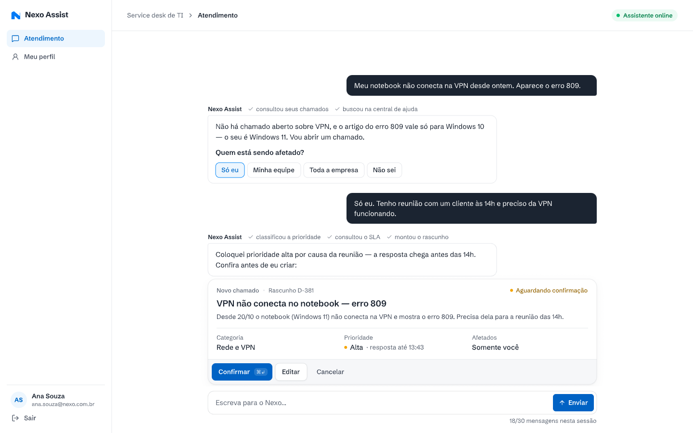
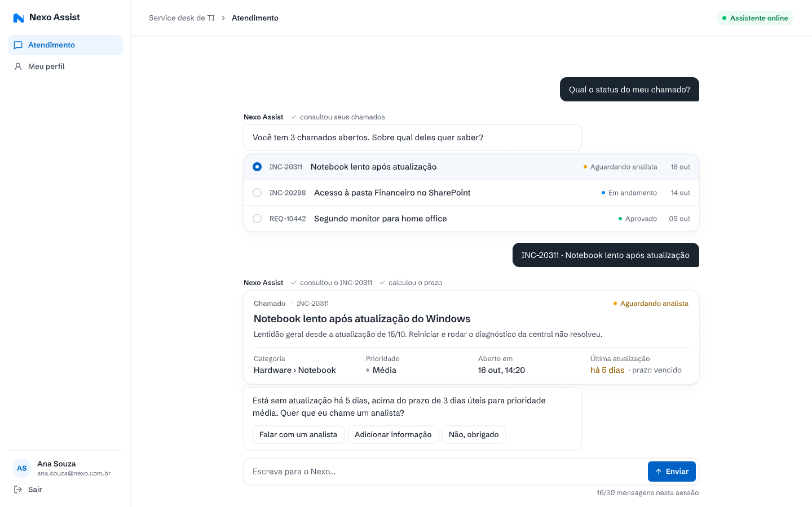

# Chat do funcionário (Telas 02 e 03)

**Approved**: 2026-10-28 - user: "Aprovo todas as recomendações Q-01 a Q-16"

Tamanho: Large · Fonte: PDF (O que construir 2, histórias 1 a 6) + protótipo (Telas 02 e 03) · Status: Specify aprovado em 2026-10-28

## Problem Statement

O funcionário conversa com o Nexo Assist numa tela de chat. As respostas chegam em tempo real e trazem elementos ricos: card de chamado, lista de seleção, rascunho para confirmar e perguntas com opções rápidas. A conversa precisa sobreviver a um reinício e continuar em outro dia, mostrar quando um analista assumiu e ter limite de 30 mensagens por sessão. A tela segue o protótipo e tem estados de carregamento e erro.

## Goals

- [ ] Telas fiéis a `02-chat-novo-chamado.png` e `03-chat-consulta-transferencia.png` em 1440x900.
- [ ] Respostas em streaming com as ações aparecendo enquanto o agent trabalha.
- [ ] Todos os controles desenhados com comportamento definido.
- [ ] Conversa persistida e retomada, incluindo o estado com analista.

## Out of Scope

| Item | Motivo |
| --- | --- |
| Anexar arquivos e imagens | Não está no PDF nem no protótipo. |
| Várias conversas em paralelo e lista de conversas do funcionário | O protótipo mostra uma conversa só (Q-06). |
| Notificação push ou por e-mail | Não citado. |
| Layout mobile | Q-15. |

## Assumptions & Open Questions

| Assumption | Chosen default | Rationale | Confirmed? |
| --- | --- | --- | --- |
| Limite de 30 (Q-05) | Conta mensagens do funcionário na conversa (texto, opção rápida e seleção; Confirmar, Editar e Cancelar não contam). | O contador "18/30 mensagens nesta sessão" fala de mensagens; botões do rascunho não são mensagens. | y - recomendação aprovada (AD-005) |
| No limite (Q-05) | Envio travado com "Você chegou ao limite de 30 mensagens nesta conversa." e as ações "Falar com um analista" e "Nova conversa". | O PDF pede o limite, não o que fazer depois. | y - recomendação aprovada (AD-005) |
| Sessão (Q-06) | Uma conversa ativa por funcionário, contínua entre dias, até ser encerrada ou resolvida. | História 6. | y - recomendação aprovada (AD-005) |
| Rascunho com Tipo (Q-02) | O rascunho ganha "Tipo" (Incidente ou Requisição) ao lado de "Categoria". | O PDF exige tipo; o protótipo não mostra. | y - recomendação aprovada (AD-003) |
| Atalhos | Confirmar com ⌘↵ no Mac e Ctrl+Enter no Windows; teclas 1 a 4 escolhem a opção quando o campo de texto está vazio. | O protótipo mostra "⌘↵" e opções numeradas. | y - recomendação aprovada em 2026-10-28 |
| Transporte do streaming | Decidido no Design (SSE pelo Hono ou equivalente). | Restrição de Cloudflare Workers. | y - recomendação aprovada em 2026-10-28 |
| Primeira visita | Mensagem do Nexo Assist: "Olá, <primeiro nome>! Descreva o que está acontecendo que eu consulto seus chamados e a central de ajuda." | O protótipo não desenha a conversa vazia. | y - recomendação aprovada em 2026-10-28 |
| Status do rascunho | "Aguardando confirmação", "Chamado criado · <número>", "Cancelado". | Só o primeiro aparece no protótipo. | y - recomendação aprovada em 2026-10-28 |

**Open questions:** none - Q-02, Q-05, Q-06, Q-12, Q-15, Q-16 respondidas em 2026-10-28 ("Aprovo todas as recomendações Q-01 a Q-16"); decisões em `STATE.md` (AD-003, AD-005, AD-009, AD-011).

## User Stories

### P1: Conversar com o agent ⭐ MVP

**User Story**: Como funcionário, quero escrever e ver a resposta chegando em tempo real.

**Why P1**: O que construir 2.

**Acceptance Criteria**:

1. WHEN o funcionário abre `/atendimento` THEN o sistema SHALL mostrar a tela como `.specs/features/chat-funcionario/captures/02-chat-novo-chamado.png`: barra lateral com "Atendimento" e "Meu perfil", o usuário e "Sair"; barra superior "Service desk de TI › Atendimento" com o selo "Assistente online"; a conversa; o campo "Escreva para o Nexo…" com "Enviar" e o contador. [Protótipo] `CHAT-01`
2. WHEN o funcionário envia uma mensagem THEN o sistema SHALL mostrá-la na hora, à direita, e a resposta do agent SHALL aparecer em streaming, palavra a palavra. [PDF] `CHAT-02`
3. WHILE o agent responde o sistema SHALL desabilitar "Enviar" e mostrar as ações em andamento acima da resposta. [PDF] `CHAT-03`
4. IF a mensagem está vazia ou só tem espaços THEN o sistema SHALL manter "Enviar" desabilitado. [Proposta] `CHAT-04`
5. IF a mensagem passa de 2.000 caracteres THEN o sistema SHALL impedir o envio e mostrar "Máximo de 2.000 caracteres." [Proposta] `CHAT-05`
6. WHEN o funcionário aperta Enter THEN o sistema SHALL enviar; WHEN aperta Shift+Enter THEN o sistema SHALL quebrar a linha. [Proposta] `CHAT-06`
7. WHEN chega uma mensagem nova e a conversa está no fim THEN o sistema SHALL rolar até ela; WHILE o funcionário está lendo mais acima o sistema SHALL mostrar o botão "Novas mensagens" em vez de rolar. [Proposta] `CHAT-07`
8. WHEN é a primeira conversa do funcionário THEN o sistema SHALL mostrar a mensagem de boas-vindas do Nexo Assist. [Proposta] `CHAT-08`
9. IF o servidor do agent não responde ao teste de saúde THEN o selo SHALL mudar de "Assistente online" para "Assistente indisponível". [Proposta] `CHAT-09`

**Independent Test**: Enviar "Meu notebook não conecta na VPN" mostra a mensagem, as ações em andamento e a resposta chegando aos poucos.

---

### P1: Responder com opções e escolher chamados ⭐ MVP

**User Story**: Como funcionário, quero responder perguntas com um clique e escolher o chamado de uma lista.

**Why P1**: O que construir 2 (perguntas com opções rápidas, seleção de chamado).

**Acceptance Criteria**:

1. WHEN o agent faz uma pergunta com opções THEN o sistema SHALL mostrar a pergunta com as opções numeradas, como "Quem está sendo afetado?" em `02-chat-novo-chamado.png`. [Protótipo] `CHAT-10`
2. WHEN o funcionário clica numa opção, ou aperta o número dela com o campo vazio THEN o sistema SHALL enviar o texto da opção como mensagem dele e desabilitar as outras opções daquela pergunta. [Protótipo] `CHAT-11`
3. WHEN o agent pede para escolher um chamado THEN o sistema SHALL mostrar a lista como `.specs/features/chat-funcionario/captures/03-chat-consulta-transferencia.png`: um item por chamado com número, título, status colorido e data. [Protótipo] `CHAT-12`
4. WHEN o funcionário escolhe um chamado THEN o sistema SHALL enviar "<número> · <título>" como mensagem dele e travar a lista. [Protótipo] `CHAT-13`
5. WHEN o agent mostra um chamado THEN o sistema SHALL desenhar o card "Chamado · <número>" com status, título, descrição, Categoria, Prioridade, Aberto em e Última atualização, como em `03-chat-consulta-transferencia.png`. [Protótipo] `CHAT-14`
6. IF o chamado do card está vencido THEN o sistema SHALL mostrar "prazo vencido" na cor de alerta ao lado da última atualização. [Protótipo] `CHAT-15`
7. WHEN o agent oferece "Falar com um analista", "Adicionar informação" e "Não, obrigado" THEN o sistema SHALL tratá-las como opções rápidas (CHAT-11). [Protótipo] `CHAT-16`

**Independent Test**: Na Tela 03, escolher INC-20311 envia "INC-20311 · Notebook lento após atualização" e o card aparece com "prazo vencido".

---

### P1: Conferir e confirmar o rascunho ⭐ MVP

**User Story**: Como funcionário, quero conferir os dados antes de o chamado ser criado.

**Why P1**: História 4.

**Acceptance Criteria**:

1. WHEN o agent monta um rascunho THEN o sistema SHALL desenhar o card "Novo chamado · Rascunho <id>" com "Aguardando confirmação", título, descrição, Categoria, Tipo, Prioridade com "resposta até HH:MM", Afetados e os botões "Confirmar ⌘↵", "Editar" e "Cancelar", como em `02-chat-novo-chamado.png`. [Protótipo] `CHAT-17`
2. WHEN o funcionário usa "Confirmar" ou o atalho THEN o sistema SHALL mandar a confirmação uma vez só, desabilitar os botões e, quando o chamado existir, trocar o status do card para "Chamado criado · <número>". [PDF] `CHAT-18`
3. WHEN o funcionário usa "Editar" THEN o sistema SHALL transformar os campos do card em campos editáveis com "Salvar" e "Descartar alterações". [Proposta] `CHAT-19`
4. WHEN o funcionário usa "Cancelar" THEN o sistema SHALL trocar o status para "Cancelado" e tirar os botões. [Protótipo] `CHAT-20`
5. IF a confirmação falha THEN o sistema SHALL manter o rascunho com os botões ativos e mostrar o aviso do agent. [PDF] `CHAT-21`

**Independent Test**: Clicar duas vezes rápido em "Confirmar" cria um chamado só.

---

### P1: Limite de mensagens ⭐ MVP

**User Story**: Como Nexo, quero limitar cada sessão a 30 mensagens, para controlar o custo.

**Why P1**: O que construir 2.

**Acceptance Criteria**:

1. The sistema SHALL mostrar abaixo do campo "N/30 mensagens nesta sessão", contando só as mensagens do funcionário na conversa. [Protótipo] `CHAT-22`
2. WHEN o funcionário chega a 30 mensagens THEN o sistema SHALL travar o envio, mostrar "Você chegou ao limite de 30 mensagens nesta conversa." e oferecer "Falar com um analista" e "Nova conversa". [Proposta] `CHAT-23`
3. The servidor SHALL recusar a 31ª mensagem da conversa mesmo que a tela permita. [PDF] `CHAT-24`

**Independent Test**: Na 30ª mensagem o campo trava; uma chamada direta à API com a 31ª é recusada.

---

### P1: Voltar outro dia e acompanhar o analista ⭐ MVP

**User Story**: Como funcionário, quero voltar e continuar de onde parei, e falar com o analista na mesma tela.

**Why P1**: Histórias 5 e 6; persistência do PDF.

**Acceptance Criteria**:

1. WHEN o funcionário volta ao chat (recarga, outro dia ou depois de reiniciar a aplicação) THEN o sistema SHALL mostrar a conversa ativa com todo o histórico, os cards no estado final e o contador. [PDF] `CHAT-25`
2. WHILE o histórico carrega o sistema SHALL mostrar esqueletos de mensagem. [PDF] `CHAT-26`
3. WHILE a conversa está aguardando atendente o sistema SHALL mostrar a faixa "Aguardando um analista · contato até HH:MM" e deixar o funcionário escrever, sem resposta do agent. [PDF] `CHAT-27`
4. WHEN um analista assume, responde, devolve ou encerra THEN o sistema SHALL mostrar em até 3 segundos a mensagem do analista com nome e equipe, ou a linha de sistema ("Rafael Lima assumiu", "Você voltou a falar com o Nexo Assist", "Atendimento encerrado"). [PDF] `CHAT-28`
5. WHEN a conversa foi encerrada ou resolvida e o funcionário escreve THEN o sistema SHALL abrir uma conversa nova com o contador zerado. [Proposta] `CHAT-29`

**Independent Test**: Transferir, assumir no console e responder: a mensagem do analista aparece no chat da Ana sem recarregar.

---

### P1: Erros de rede e do agent ⭐ MVP

**User Story**: Como funcionário, quero não perder o que escrevi quando algo falha.

**Why P1**: Critério "Interface: estados de carregamento e erro".

**Acceptance Criteria**:

1. IF o envio falha THEN o sistema SHALL marcar a mensagem com "Não enviada · Tentar de novo" e manter o texto. [PDF] `CHAT-30`
2. IF o streaming cai no meio THEN o sistema SHALL manter o texto parcial com "Resposta interrompida · Tentar de novo". [PDF] `CHAT-31`
3. The sistema SHALL caber sem rolagem horizontal em janelas de 1280 px ou mais. [Proposta] `CHAT-32`
4. WHEN o funcionário usa "Sair" ou "Meu perfil" THEN o sistema SHALL seguir AUTH-16 e AUTH-17, mantendo a conversa salva. [Protótipo] `CHAT-33`

**Independent Test**: Derrubar a rede no meio da resposta mostra "Resposta interrompida" e "Tentar de novo" refaz a resposta.

---

## Edge Cases

- Recarregar a página no meio de um streaming: a resposta aparece completa quando termina no servidor, ou marcada como interrompida.
- Duas abas abertas: as duas mostram as mesmas mensagens; só uma envia por vez porque o servidor ordena por conversa.
- Opção rápida de uma pergunta antiga, já respondida: fica desabilitada.

## Implicit-Requirement Dimensions

| Dimension | Coverage |
| --- | --- |
| Input validation & bounds | CHAT-04, CHAT-05, CHAT-24 |
| Failure / partial-failure states | CHAT-21, CHAT-30, CHAT-31 |
| Idempotency / retry / duplicate handling | CHAT-18 (uma confirmação), CHAT-30 (reenvio da mesma mensagem) |
| Auth boundaries & rate limits | CHAT-24; acesso em AUTH-14 |
| Concurrency / ordering | CHAT-03, edge case de duas abas |
| Data lifecycle / expiry | CHAT-25, CHAT-29 |
| Observability | Registro de decisão em `transparencia` |
| External-dependency failure | CHAT-09, CHAT-21 |
| State-transition integrity | CHAT-27, CHAT-28, CHAT-29 |

## Requirement Traceability

| ID | Story | Phase | Status |
| --- | --- | --- | --- |
| CHAT-01 | P1 - Conversar com o agent | Specify | Pending |
| CHAT-02 | P1 - Conversar com o agent | Specify | Pending |
| CHAT-03 | P1 - Conversar com o agent | Specify | Pending |
| CHAT-04 | P1 - Conversar com o agent | Specify | Pending |
| CHAT-05 | P1 - Conversar com o agent | Specify | Pending |
| CHAT-06 | P1 - Conversar com o agent | Specify | Pending |
| CHAT-07 | P1 - Conversar com o agent | Specify | Pending |
| CHAT-08 | P1 - Conversar com o agent | Specify | Pending |
| CHAT-09 | P1 - Conversar com o agent | Specify | Pending |
| CHAT-10 | P1 - Responder com opções e escolher chamados | Specify | Pending |
| CHAT-11 | P1 - Responder com opções e escolher chamados | Specify | Pending |
| CHAT-12 | P1 - Responder com opções e escolher chamados | Specify | Pending |
| CHAT-13 | P1 - Responder com opções e escolher chamados | Specify | Pending |
| CHAT-14 | P1 - Responder com opções e escolher chamados | Specify | Pending |
| CHAT-15 | P1 - Responder com opções e escolher chamados | Specify | Pending |
| CHAT-16 | P1 - Responder com opções e escolher chamados | Specify | Pending |
| CHAT-17 | P1 - Conferir e confirmar o rascunho | Specify | Pending |
| CHAT-18 | P1 - Conferir e confirmar o rascunho | Specify | Pending |
| CHAT-19 | P1 - Conferir e confirmar o rascunho | Specify | Pending |
| CHAT-20 | P1 - Conferir e confirmar o rascunho | Specify | Pending |
| CHAT-21 | P1 - Conferir e confirmar o rascunho | Specify | Pending |
| CHAT-22 | P1 - Limite de mensagens | Specify | Pending |
| CHAT-23 | P1 - Limite de mensagens | Specify | Pending |
| CHAT-24 | P1 - Limite de mensagens | Specify | Pending |
| CHAT-25 | P1 - Voltar outro dia e acompanhar o analista | Specify | Pending |
| CHAT-26 | P1 - Voltar outro dia e acompanhar o analista | Specify | Pending |
| CHAT-27 | P1 - Voltar outro dia e acompanhar o analista | Specify | Pending |
| CHAT-28 | P1 - Voltar outro dia e acompanhar o analista | Specify | Pending |
| CHAT-29 | P1 - Voltar outro dia e acompanhar o analista | Specify | Pending |
| CHAT-30 | P1 - Erros de rede e do agent | Specify | Pending |
| CHAT-31 | P1 - Erros de rede e do agent | Specify | Pending |
| CHAT-32 | P1 - Erros de rede e do agent | Specify | Pending |
| CHAT-33 | P1 - Erros de rede e do agent | Specify | Pending |

**Coverage:** 33 critérios, todos mapeados a uma história.

## Sources

 - binding - Chat com pergunta de opções rápidas ("Quem está sendo afetado?"), ações acima das respostas e o rascunho D-381 com Confirmar, Editar e Cancelar; contador 18/30.

 - binding - Consulta de status: lista de seleção de chamados, card do INC-20311 com "prazo vencido" e as opções "Falar com um analista", "Adicionar informação", "Não, obrigado"; contador 16/30.

- `../../source/desafio-prd.md`: O que construir 2, histórias 1 a 6, Requisitos técnicos (persistência), Critérios (interface).
- `../../source/prototipo.md`: textos e tokens.

## Differences from the source

| Source shows | Product shows | Confirmed |
| --- | --- | --- |
| Rascunho sem o campo "Tipo" | Campo "Tipo" (Incidente ou Requisição) ao lado de "Categoria" no rascunho e no card do chamado | y - AD-003 |
| "Quer que eu chame um analista?" para chamado vencido | A mesma pergunta; transfere só no "sim". Pedido explícito e Crítica transferem direto | y - AD-004 |
| Nenhum estado de espera por analista | Faixa "Aguardando um analista" com o prazo de contato "até HH:MM" e as mensagens do analista no chat (CHAT-27, CHAT-28) | y - AD-004 |
| Nenhum limite de mensagens | No limite de 30 mensagens do funcionário, envio travado com "Falar com um analista" e "Nova conversa" | y - AD-005 |
| Tema claro | Tema claro, sem o alternador de tema da base | y - AD-011 |

## Success Criteria

- [ ] As duas telas batem com as capturas em 1440x900.
- [ ] Todo controle desenhado tem um critério e um teste.
- [ ] Reiniciar o servidor no meio de uma conversa não perde mensagem nem rascunho.
