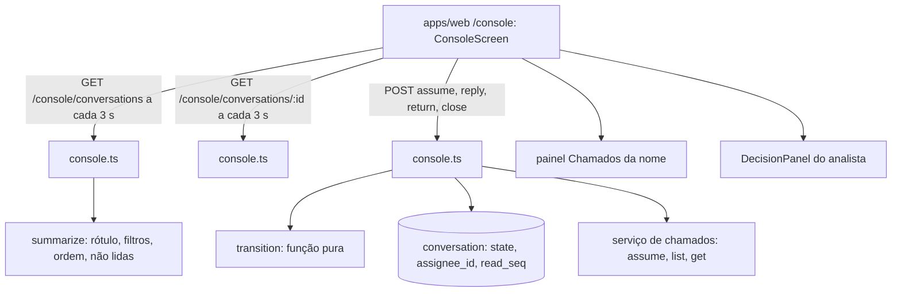

# Console do analista Design

**Spec**: `.specs/features/console-analista/spec.md`
**Status**: Approved
**Approved**: 2026-10-28 - user: "sim, faça a aplicação de todas as features, me avise se precisar de algo" (delegado por André em t152u; abordagem A e D-01 a D-08 recomendadas adotadas, AD-020)

---

## Approaches

### A. Rotas Hono `/console/*` + resumo calculado no servidor + polling (recomendada)

O Worker expõe a lista (`GET /console/conversations`, com itens, contadores e filtros já calculados), a conversa (`GET /console/conversations/:id`, que zera as não lidas), os chamados do funcionário e as ações (`assume`, `reply`, `return`, `close`). As transições ficam numa função pura (`transition`), e a troca de estado no banco é condicional (`UPDATE … WHERE state IN (…)`), então dois analistas que assumem juntos não ganham os dois. A tela faz polling de 3 s na lista e na conversa aberta.

- **Prós**: o mesmo padrão do chat (Hono, `app.request()` nos testes); regras e contadores testáveis sem tela; nada novo no Cloudflare.
- **Contras**: polling gasta requisições; 3 s cabe nos 5 s do CON-10.

### B. tRPC para o console

- **Contras**: duas formas de falar com o servidor no mesmo app; o chat já usa Hono puro.

### C. Durable Object por conversa com WebSocket

- **Contras**: recurso novo no Cloudflare e estado fora do D1 só para empurrar mudanças.

**Recomendação: A** (adotada).

---

## Decisions

| ID | Decisão | Por quê |
| --- | --- | --- |
| D-01 | Estados no banco seguem os do `agent` (`agent`, `aguardando_analista`, `com_analista`, `encerrada`), que são os `com_agent`, `aguardando_atendente`, `com_analista` e `encerrada` da spec. | Sem renomear dados já gravados |
| D-02 | "Resolvida pelo agent" é calculada na leitura: conversa em `agent` cuja última mensagem é do agent e tem mais de 24 h. Não sai do filtro "Todas", sai de "Com o agent". A regra "o funcionário disse que resolveu" fica fora (o entendimento não tem essa intenção). | Sem job agendado no Worker; desvio registrado |
| D-03 | Novas colunas em `conversation`: `assignee_id` (analista responsável) e `read_seq` (última mensagem lida no console). Não lidas = mensagens do funcionário depois de `read_seq`. Um contador por conversa, não por analista. | Simples; o protótipo mostra um número por conversa |
| D-04 | Transições: assumir a partir de `aguardando_analista` ou `agent`; responder, devolver e encerrar só por quem assumiu; devolver também a partir de `aguardando_analista`; encerrar também a partir de `aguardando_analista` e `agent`. Assumir de novo a própria conversa não muda nada (idempotente). Assumida por outro: `TAKEN` com o nome. O resto: `INVALID_TRANSITION`. | CON-23 a CON-29 |
| D-05 | O chamado da conversa é o último alvo de `chamados.transferir` nas decisões; sem ele, o último chamado mostrado ou criado. Assumir chama `tickets.assume` antes de gravar; se o serviço falha, a conversa volta ao estado anterior e a tela mostra o aviso. | CON-23, CON-30 |
| D-06 | "Disponível" fica no navegador (`localStorage`), só zera o badge. | CON-12; sem presença no servidor |
| D-07 | Busca por nome e números de chamado no cliente, sem acento e sem maiúscula, sobre a lista que o servidor manda. | CON-08 |
| D-08 | Painel de chamados: `list(analyst, { requesterId })` e `get` do chamado da conversa (último evento). "Outros chamados" mostra 4; "Ver todos" mostra o resto. A seta carrega o detalhe. | CON-16 a CON-18 |

---

## Architecture Overview

## Code Reuse Analysis

| Component | Location | How to Use |
| --- | --- | --- |
| `createAgent().assume/analystSays/returnToAgent/close` | `packages/agent/src/engine.ts` | Linhas de sistema e mensagens do analista |
| `createTicketService` | `apps/server/src/tickets.ts` | Ator analista vindo da sessão |
| `ActionLine`, `DecisionPanel` | `apps/web/src/features/decision` | Linha de ações e painel do analista (TRN-14) |
| `Bubble`, `TicketCard` labels | `apps/web/src/features/chat/blocks.tsx` | Tons de status |
| `agentHarness`, `seededDb` | `packages/agent/src/testing.ts` | Testes do servidor |

## Components

### Transições (`packages/agent/src/console.ts`)

- `transition(conv, action, me)`: `{ ok: true, state, assignee } | { ok: false, code: "TAKEN" | "INVALID_TRANSITION" | "NOT_YOURS" }`.
- `summarize(conv, messages, now, me)`: `status` (`transferida`, `pediu_ajuda`, `agent`, `resolvida`, `voce`, `outro_analista`, `encerrada`), ticket, contato, confiança, prévia, hora, não lidas, números de chamado.
- `filterCounts(items)`, `order(items)`, `inFilter(item, filter)`.

### Store

- `listAll()`: conversas com nome e setor do funcionário e mensagens.
- `claim(id, from, assignee)`: troca condicional; devolve `false` se outro ganhou.
- `markRead(id, seq)`.

### Rotas (`apps/server/src/console.ts`)

- `GET /console/conversations` → `{ items, counts, me }`.
- `GET /console/conversations/:id` → cabeçalho, mensagens e zera não lidas.
- `GET /console/conversations/:id/tickets` → `{ current, tickets }`; `GET /console/tickets/:number` → detalhe.
- `POST /console/conversations/:id/{assume,reply,return,close}`.
- Erros: 401, 403 (funcionário), 404, 409 `TAKEN`/`INVALID_TRANSITION`/`NOT_YOURS`, 400 texto, 503 serviço.

### Tela (`apps/web/src/features/console`)

- `api.ts`: `ConsoleApi` e cliente `fetch`.
- `labels.ts`: rótulos, hora relativa, busca sem acento.
- `conversation-list.tsx`: trilho, lista, filtros, busca, badge, "Disponível".
- `conversation-view.tsx`: cabeçalho, mensagens, faixa de assumir, campo, menu "⋮", lupa, confirmação de encerrar.
- `tickets-panel.tsx`: "Chamados da <nome>", "Desta conversa", "Outros chamados", "Ver todos", detalhe, X.
- `console-screen.tsx`: junta tudo com polling.

## Error Handling Strategy

| Error Scenario | Handling | User Impact |
| --- | --- | --- |
| Outro analista assumiu | 409 `TAKEN` | "<nome> já assumiu esta conversa." e recarrega |
| Ação falha (rede, 503) | Estado anterior mantido | Aviso "Não foi possível concluir. Tente de novo." |
| Chamados não carregam | Painel em erro | "Não foi possível carregar os chamados · Tentar de novo" |
| Transição inválida | 409 `INVALID_TRANSITION` | Aviso e recarrega |

## Tech Decisions

| Decision | Choice | Rationale |
| --- | --- | --- |
| Atualização | Polling de 3 s | CON-10 em até 5 s |
| Corrida ao assumir | `UPDATE … WHERE state IN (…) RETURNING` | Um ganha, o outro recebe `TAKEN` |
| Migração | `drizzle-kit generate` | Como as anteriores |
