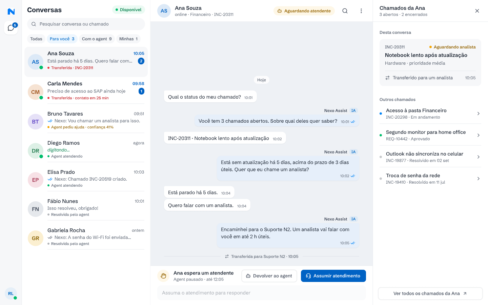
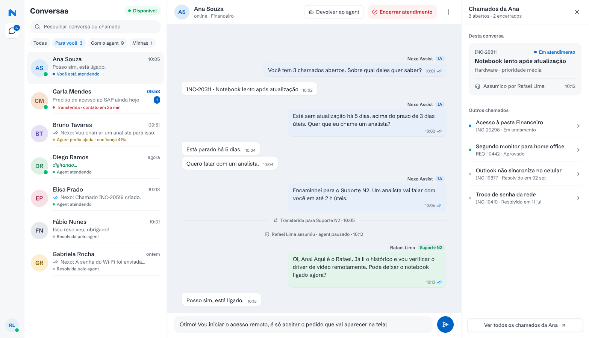

# Console do analista (Telas 04 e 05)

**Approved**: 2026-10-28 - user: "Aprovo todas as recomendações Q-01 a Q-16"

Tamanho: Large · Fonte: PDF (O que construir 5 e 6, histórias do analista) + protótipo (Telas 04 e 05) · Status: Specify aprovado em 2026-10-28

## Problem Statement

Os analistas do Suporte N1 e N2 precisam ver as conversas que dependem deles, incluindo aquelas em que o agent não teve segurança, ler o histórico, assumir com o agent pausado, responder e depois devolver ao agent ou encerrar. Ao lado, um painel com os chamados do funcionário evita perguntar tudo de novo. O estado de cada conversa precisa sobreviver a um reinício.

## Goals

- [ ] Telas fiéis a `04-console-conversa-transferida.png` e `05-console-atendimento-assumido.png`.
- [ ] Estados da conversa com transições válidas, guardadas no servidor e testadas.
- [ ] Filtros e contadores certos, calculados no servidor.
- [ ] Todo controle desenhado com comportamento definido (Q-12).

## Out of Scope

| Item | Motivo |
| --- | --- |
| Distribuição automática de conversas entre analistas | O PDF não pede; o analista escolhe. |
| Edição de campos do chamado pelo console | O PDF pede o painel de chamados, não um editor. Resolver chamado fica fora. |
| Presença em tempo real ("digitando…") e confirmação de leitura (✓✓) | Q-12: recomendação é tirar. |
| Métricas da equipe | Não citado. |

## Assumptions & Open Questions

| Assumption | Chosen default | Rationale | Confirmed? |
| --- | --- | --- | --- |
| Estados da conversa | `com_agent` → `aguardando_atendente` → `com_analista` → `com_agent` ou `encerrada`; `com_agent` → `resolvida` quando o agent resolve; `aguardando_atendente` → `com_agent` por "Devolver ao agent". | Os rótulos do protótipo: "Agent atendendo", "Transferida", "Agent pediu ajuda", "Você está atendendo", "Resolvida pelo agent". | y - recomendação aprovada em 2026-10-28 |
| Assumir uma conversa que está com o agent | Permitido, pelo "⋮". | História 3 do analista não restringe. | y - recomendação aprovada em 2026-10-28 |
| Filtros | "Para você" = aguardando atendente; "Com o agent" = `com_agent`; "Minhas" = `com_analista` comigo; "Todas" = todas menos encerradas há mais de 7 dias. | Os contadores do protótipo (3, 9, 1). | y - recomendação aprovada em 2026-10-28 |
| Ordem da lista | Aguardando atendente primeiro, pelo prazo de contato mais próximo; depois as demais pela última mensagem. | No protótipo as transferidas ficam no topo. | y - recomendação aprovada em 2026-10-28 |
| "Resolvida pelo agent" | O agent marca `resolvida` quando o funcionário diz que resolveu ou fica 24 h sem escrever depois de uma resposta da central. | O PDF não define; o protótipo mostra o rótulo. | y - recomendação aprovada em 2026-10-28 |
| Controles sem comportamento no PDF (Q-12) | Ver a tabela abaixo. | Recomendação; o André decide. | y - recomendação aprovada (AD-009) |
| Atualização ao vivo | Até 5 segundos, por polling ou SSE (Design). | Sem notificações no PDF. | y - recomendação aprovada em 2026-10-28 |

| Controle do protótipo | Recomendação (Q-12) |
| --- | --- |
| "Disponível" | Desligado, o analista some do aviso "Para você" (badge zerado), mas continua vendo a lista. |
| Lupa no cabeçalho da conversa | Busca texto dentro da conversa aberta e destaca os resultados. |
| "⋮" no cabeçalho | Menu com "Ver decisões do agent", "Assumir atendimento" e "Encerrar atendimento". |
| Badge "5" no ícone Conversas | Número de conversas em "Para você". |
| "Ver todos os chamados da Ana ↗" | Expande no painel a lista com todos os chamados, abertos e encerrados. |
| Seta "›" de cada chamado | Expande o detalhe do chamado (descrição, notas, eventos) no painel. |
| X do painel | Fecha o painel; um botão no cabeçalho reabre. |
| "digitando…" e ✓✓ | Sair (sem presença em tempo real). |
| "Agent pausado · até 12:05" | Mostra o prazo de contato (Q-04). |

**Open questions:** none - Q-03, Q-04, Q-12, Q-15, Q-16 respondidas em 2026-10-28 ("Aprovo todas as recomendações Q-01 a Q-16"); decisões em `STATE.md` (AD-004, AD-009, AD-011).

## User Stories

### P1: Ver as conversas que precisam de mim ⭐ MVP

**User Story**: Como analista, quero ver as conversas que precisam de mim, inclusive as em que o agent não teve segurança.

**Why P1**: História 2 do analista.

**Acceptance Criteria**:

1. WHEN o analista abre `/console` THEN o sistema SHALL mostrar a tela como `.specs/features/console-analista/captures/04-console-conversa-transferida.png`: trilho à esquerda, lista "Conversas", conversa aberta no centro e o painel "Chamados da <nome>" à direita. [Protótipo] `CON-01`
2. The lista SHALL mostrar em cada conversa as iniciais, o nome, a hora da última mensagem, a prévia, as não lidas e o rótulo do estado: "Transferida · <número>", "Transferida · contato em N min", "Agent pediu ajuda · confiança NN%", "Agent atendendo", "Você está atendendo", "Resolvida pelo agent" ou "Encerrada". [Protótipo] `CON-02`
3. The filtro "Para você" SHALL listar as conversas aguardando atendente, com o total ao lado. [Protótipo] `CON-03`
4. The filtro "Com o agent" SHALL listar as conversas em `com_agent`, com o total ao lado. [Protótipo] `CON-04`
5. The filtro "Minhas" SHALL listar as conversas que o analista da sessão assumiu e ainda atende, com o total ao lado. [Protótipo] `CON-05`
6. The filtro "Todas" SHALL listar todas as conversas, menos as encerradas há mais de 7 dias. [Proposta] `CON-06`
7. The sistema SHALL ordenar as conversas aguardando atendente primeiro, pelo prazo de contato mais próximo, e as demais pela última mensagem. [Proposta] `CON-07`
8. WHEN o analista digita em "Pesquisar conversa ou chamado" THEN o sistema SHALL filtrar por nome do funcionário ou número de chamado, sem diferenciar maiúsculas e acentos. [Protótipo] `CON-08`
9. IF um filtro ou busca não tem resultado THEN o sistema SHALL mostrar "Nenhuma conversa aqui." [Proposta] `CON-09`
10. WHEN uma conversa nova chega ou muda de estado THEN a lista e os contadores SHALL se atualizar em até 5 segundos, sem recarregar. [PDF] `CON-10`
11. The badge do ícone Conversas SHALL mostrar o total de "Para você". [Proposta] `CON-11`
12. WHERE o analista desligou "Disponível" o sistema SHALL zerar o badge dele e manter a lista. [Proposta] `CON-12`

**Independent Test**: Com o seed, "Para você", "Com o agent" e "Minhas" mostram os totais que a consulta ao banco devolve.

---

### P1: Ler a conversa e os chamados do funcionário ⭐ MVP

**User Story**: Como analista, quero ver o histórico e os chamados do funcionário sem perguntar tudo de novo.

**Why P1**: Histórias 1 e 2 do analista; O que construir 6.

**Acceptance Criteria**:

1. WHEN o analista abre uma conversa THEN o sistema SHALL mostrar o histórico completo com hora de cada mensagem, separador de dia ("Hoje"), o selo "IA" nas mensagens do agent, nome e equipe nas do analista e as linhas de sistema ("Transferida para Suporte N2 · 10:05"). [Protótipo] `CON-13`
2. The cabeçalho SHALL mostrar o nome, o setor, o chamado da conversa e o selo do estado ("Aguardando atendente", "Em atendimento"); o chamado aparece no cabeçalho só enquanto a conversa aguarda atendente, como nas capturas 04 e 05 (André, 2026-10-28: "Seguir a captura (Recomendado)"). [Protótipo] `CON-14`
3. WHEN o analista abre uma conversa THEN o sistema SHALL zerar as não lidas dela. [Proposta] `CON-15`
4. The painel SHALL mostrar "Chamados da <nome>", "N abertos · M encerrados", o bloco "Desta conversa" com status, título, categoria, prioridade e último evento, e o bloco "Outros chamados". [Protótipo] `CON-16`
5. WHEN o analista usa "Ver todos os chamados da <nome> ↗" THEN o sistema SHALL expandir no painel a lista de todos os chamados dela. [Proposta] `CON-17`
6. WHEN o analista usa a seta de um chamado THEN o sistema SHALL expandir descrição, notas e eventos dele no painel. [Proposta] `CON-18`
7. WHEN o analista usa o X do painel THEN o sistema SHALL fechar o painel e mostrar no cabeçalho um botão que o reabre. [Protótipo] `CON-19`
8. WHEN o analista usa a lupa do cabeçalho THEN o sistema SHALL buscar o texto na conversa aberta e destacar os resultados. [Proposta] `CON-20`
9. WHEN o analista usa "⋮" THEN o sistema SHALL abrir o menu com "Ver decisões do agent", "Assumir atendimento" e "Encerrar atendimento", habilitados conforme o estado. [Proposta] `CON-21`

**Independent Test**: Abrir a conversa da Ana mostra o histórico da transferência e o painel com INC-20311 em "Desta conversa".

---

### P1: Assumir, responder, devolver e encerrar ⭐ MVP

**User Story**: Como analista, quero assumir uma conversa com o agent pausado e depois devolver ou encerrar.

**Why P1**: História 3 do analista; O que construir 5 e 6.

**Acceptance Criteria**:

1. WHILE a conversa está aguardando atendente o sistema SHALL mostrar a faixa "<nome> espera um atendente" com "Agent pausado · até HH:MM", os botões "Devolver ao agent" e "Assumir atendimento", e o campo desabilitado "Assuma o atendimento para responder". [Protótipo] `CON-22`
2. WHEN o analista usa "Assumir atendimento" THEN o servidor SHALL passar a conversa para `com_analista` com ele como responsável, gravar "<analista> assumiu · agent pausado · HH:MM" e mudar o chamado para "Em atendimento" com o evento "Assumido por <analista>", e a tela SHALL ficar como `.specs/features/console-analista/captures/05-console-atendimento-assumido.png`. [Protótipo] `CON-23`
3. IF outro analista já assumiu a conversa THEN o servidor SHALL recusar e a tela SHALL mostrar "<nome> já assumiu esta conversa." e atualizar. [Proposta] `CON-24`
4. WHILE a conversa está com o analista da sessão o sistema SHALL habilitar o campo de resposta e mostrar no cabeçalho "Devolver ao agent" e "Encerrar atendimento". [Protótipo] `CON-25`
5. WHEN o analista envia uma resposta THEN o sistema SHALL mostrá-la com "<nome> · <equipe>" e entregá-la ao chat do funcionário. [PDF] `CON-26`
6. WHEN o analista usa "Devolver ao agent" THEN o servidor SHALL passar a conversa para `com_agent`, gravar a linha de sistema e o agent SHALL responder à próxima mensagem do funcionário. [PDF] `CON-27`
7. WHEN o analista usa "Encerrar atendimento" THEN o sistema SHALL pedir confirmação e, confirmado, passar a conversa para `encerrada` e gravar a linha de sistema. [PDF] `CON-28`
8. IF uma ação pede uma transição que não existe a partir do estado atual THEN o servidor SHALL recusar com `INVALID_TRANSITION` e nada SHALL mudar. [Proposta] `CON-29`
9. IF uma ação falha THEN o sistema SHALL mostrar um aviso e manter o estado anterior na tela. [PDF] `CON-30`

**Independent Test**: Assumir, responder, devolver: o funcionário vê as três mudanças e a próxima mensagem dele recebe resposta do agent.

---

### P1: Carregar e persistir ⭐ MVP

**User Story**: Como analista, quero que o console carregue rápido e não perca nada num reinício.

**Why P1**: Persistência e estados de carregamento do PDF.

**Acceptance Criteria**:

1. WHILE a lista ou a conversa carrega o sistema SHALL mostrar esqueletos no lugar. [PDF] `CON-31`
2. WHEN a aplicação reinicia THEN o sistema SHALL manter o estado de cada conversa, o responsável e o histórico. [PDF] `CON-32`
3. WHEN uma mensagem do agent traz a pergunta no texto e nas opções THEN o console SHALL mostrar a pergunta uma vez só. [Proposta] `CON-33` (achado da caminhada de 2026-10-28)

**Independent Test**: Assumir, reiniciar o servidor e abrir o console: a conversa continua "Você está atendendo".

---

## Edge Cases

- Dois analistas clicam "Assumir" ao mesmo tempo: um ganha, o outro recebe CON-24.
- O funcionário escreve enquanto a conversa espera atendente: a mensagem aparece no console e o agent não responde.
- O analista encerra e o funcionário escreve depois: abre conversa nova (CHAT-29).
- O analista sai com conversas assumidas: elas continuam com ele até devolver ou encerrar.

## Implicit-Requirement Dimensions

| Dimension | Coverage |
| --- | --- |
| Input validation & bounds | Resposta do analista segue o limite de CHAT-05 |
| Failure / partial-failure states | CON-30 |
| Idempotency / retry / duplicate handling | CON-24, CON-29 (assumir duas vezes não muda nada) |
| Auth boundaries & rate limits | Só analistas (AUTH-14, AUTH-15) |
| Concurrency / ordering | CON-24, edge case de clique simultâneo, CON-07 |
| Data lifecycle / expiry | CON-06, CON-32 |
| Observability | Linhas de sistema (CON-13); decisões em TRN-14 |
| External-dependency failure | Painel de chamados mostra "Não foi possível carregar os chamados · Tentar de novo" quando o serviço cai (CON-30) |
| State-transition integrity | CON-22, CON-23, CON-27, CON-28, CON-29 |

## Requirement Traceability

| ID | Story | Phase | Status |
| --- | --- | --- | --- |
| CON-01 | P1 - Ver as conversas que precisam de mim | Specify | Pending |
| CON-02 | P1 - Ver as conversas que precisam de mim | Specify | Pending |
| CON-03 | P1 - Ver as conversas que precisam de mim | Specify | Pending |
| CON-04 | P1 - Ver as conversas que precisam de mim | Specify | Pending |
| CON-05 | P1 - Ver as conversas que precisam de mim | Specify | Pending |
| CON-06 | P1 - Ver as conversas que precisam de mim | Specify | Pending |
| CON-07 | P1 - Ver as conversas que precisam de mim | Specify | Pending |
| CON-08 | P1 - Ver as conversas que precisam de mim | Specify | Pending |
| CON-09 | P1 - Ver as conversas que precisam de mim | Specify | Pending |
| CON-10 | P1 - Ver as conversas que precisam de mim | Specify | Pending |
| CON-11 | P1 - Ver as conversas que precisam de mim | Specify | Pending |
| CON-12 | P1 - Ver as conversas que precisam de mim | Specify | Pending |
| CON-13 | P1 - Ler a conversa e os chamados do funcionário | Specify | Pending |
| CON-14 | P1 - Ler a conversa e os chamados do funcionário | Specify | Pending |
| CON-15 | P1 - Ler a conversa e os chamados do funcionário | Specify | Pending |
| CON-16 | P1 - Ler a conversa e os chamados do funcionário | Specify | Pending |
| CON-17 | P1 - Ler a conversa e os chamados do funcionário | Specify | Pending |
| CON-18 | P1 - Ler a conversa e os chamados do funcionário | Specify | Pending |
| CON-19 | P1 - Ler a conversa e os chamados do funcionário | Specify | Pending |
| CON-20 | P1 - Ler a conversa e os chamados do funcionário | Specify | Pending |
| CON-21 | P1 - Ler a conversa e os chamados do funcionário | Specify | Pending |
| CON-22 | P1 - Assumir, responder, devolver e encerrar | Specify | Pending |
| CON-23 | P1 - Assumir, responder, devolver e encerrar | Specify | Pending |
| CON-24 | P1 - Assumir, responder, devolver e encerrar | Specify | Pending |
| CON-25 | P1 - Assumir, responder, devolver e encerrar | Specify | Pending |
| CON-26 | P1 - Assumir, responder, devolver e encerrar | Specify | Pending |
| CON-27 | P1 - Assumir, responder, devolver e encerrar | Specify | Pending |
| CON-28 | P1 - Assumir, responder, devolver e encerrar | Specify | Pending |
| CON-29 | P1 - Assumir, responder, devolver e encerrar | Specify | Pending |
| CON-30 | P1 - Assumir, responder, devolver e encerrar | Specify | Pending |
| CON-31 | P1 - Carregar e persistir | Specify | Pending |
| CON-32 | P1 - Carregar e persistir | Specify | Pending |
| CON-33 | P1 - Carregar e persistir | Execute | Pending |

**Coverage:** 33 critérios, todos mapeados a uma história.

## Sources

 - binding - Console com a lista de conversas e filtros, a conversa da Ana aguardando atendente com a faixa de assumir, e o painel de chamados.

 - binding - Atendimento assumido por Rafael Lima: agent pausado, troca de mensagens, "Devolver ao agent" e "Encerrar atendimento", chamado "Em atendimento".

- `../../source/desafio-prd.md`: histórias do analista, O que construir 5 e 6.
- `../../source/prototipo.md`: textos e tokens.

## Differences from the source

| Source shows | Product shows | Confirmed |
| --- | --- | --- |
| "digitando…" | Nada (sem presença em tempo real) | y - AD-009 |
| ✓✓ de leitura | Nada | y - AD-009 |
| Lupa, "⋮", "Disponível", "Ver todos os chamados da Ana ↗", setas e badge "5" sem comportamento definido | Os comportamentos da tabela de Assumptions desta spec | y - AD-009 |
| "Agent pausado · até 12:05" e "contato em 25 min" | Os mesmos rótulos, calculados do prazo de contato de 2 horas úteis (Crítica: 1 hora corrida) | y - AD-004 |
| Linha de ações do agent sem detalhe | Clique abre o painel lateral "Por que o Nexo fez isso" | y - AD-007 |
| Tema claro | Tema claro, sem o alternador de tema da base | y - AD-011 |
| "online" no cabeçalho e bolinhas verdes de presença nos avatares (04, 05) | Nada (sem presença em tempo real) | y - André, 2026-10-28: "Tirar (Recomendado)" |
| "Transferido para um analista" no último evento do cartão "Desta conversa" (04) | "Transferido para <equipe>" (Suporte N1 ou N2), a equipe real do evento | y - André, 2026-10-28: "Mostrar a equipe (Recomendado)" |
| Ana (contato até 12:05) acima de Carla ("contato em 25 min") na lista (04) | Aguardando pelo prazo de contato mais próximo, como CON-07 | y - André, 2026-10-28: "Prazo mais próximo (Recomendado)" |

## Success Criteria

- [ ] As duas telas batem com as capturas.
- [ ] A máquina de estados da conversa tem teste para cada transição válida e para as inválidas.
