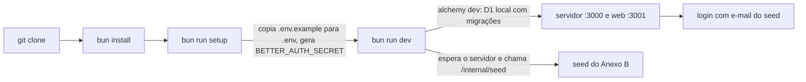

# Entrega Design

**Spec**: `.specs/features/entrega/spec.md`
**Status**: Approved
**Approved**: 2026-10-28 - user: "sim, siga com a validação do console e depois a entrega" (aprovação delegada, AD-020)

---

## Architecture Overview

A entrega não cria módulo novo. Ela fecha o caminho do avaliador: clonar, configurar e subir em três comandos, ler o README e rodar os testes e a avaliação do agent. O deploy (P3) fica pronto no `alchemy.run.ts`, mas só roda com o aval do André (AD-010).

Os três comandos depois do clone são `bun install`, `bun run setup` e `bun run dev` (DLV-04).

---

## Code Reuse Analysis

### Existing Components to Leverage

| Component | Location | How to Use |
| --- | --- | --- |
| Schemas do varlock | `apps/server/.env.schema`, `apps/web/.env.schema`, `packages/infra/.env.schema` | Fonte das variáveis; `.env.example` é testado contra eles |
| Seed idempotente | `scripts/db-seed.ts`, `apps/server/src/dev-seed.ts` | `bun run dev` chama o mesmo seed depois que o servidor responde |
| Avaliação do agent | `packages/agent/eval/cli.ts`, `run.ts`, `conversations.ts` | `--live` com Flash-Lite; resultado no README |
| Custo por chamada | `packages/agent/src/window.ts` (`estimateCost`, `PRICES`) | Base do custo estimado por conversa no README |
| Escolha do entendimento | `apps/server/src/chat-agent.ts` (`chooseUnderstander`) | Passa a ler `LLM_MODEL` |
| Estado local do Alchemy | `packages/infra/alchemy.run.ts` (AD-016) | Dev sem login Cloudflare |

### Integration Points

| System | Integration Method |
| --- | --- |
| Worker do servidor | `alchemy.run.ts` repassa `LLM_MODEL` e a chave do Gemini como binding |
| Biome | `biome.json` ignora pastas de documentação e ferramentas (`.specs`, `.agents`, `.cursor`, `.claude`) |

---

## Components

### Modelo por env

- **Purpose**: o servidor usa `LLM_MODEL` (padrão `google/gemini-3.5-flash-lite`), como o AD-008 pede.
- **Location**: `apps/server/src/chat-agent.ts`, `apps/server/.env.schema`, `packages/infra/.env.schema`, `packages/infra/alchemy.run.ts`
- **Interfaces**: `chooseUnderstander(env)` devolve `modelId = env.LLM_MODEL ?? DEFAULT_MODEL` e monta o Mastra com ele.
- **Reuses**: `createMastraUnderstander({ modelId, apiKey })`, que já aceita o modelo.

### Setup

- **Purpose**: `bun run setup` cria `apps/server/.env` e `apps/web/.env` a partir dos `.env.example`, sem sobrescrever um `.env` existente, e gera um `BETTER_AUTH_SECRET` aleatório de 48 caracteres.
- **Location**: `scripts/setup.ts`, `apps/server/.env.example`, `apps/web/.env.example`
- **Interfaces**: `setup({ root, random }): { created: string[]; kept: string[] }`

### Dev com seed

- **Purpose**: `bun run dev` sobe o Alchemy e, quando o servidor responde, roda o seed uma vez.
- **Location**: `scripts/dev.ts`
- **Interfaces**: `waitThenSeed({ url, fetch, attempts })`
- **Reuses**: `scripts/db-seed.ts`

### README

- **Purpose**: as seis seções do PDF, a escolha do modelo, o custo por conversa, a chave do AI Studio e o último resultado da avaliação.
- **Location**: `README.md`

---

## Error Handling Strategy

| Error Scenario | Handling | User Impact |
| --- | --- | --- |
| `.env` já existe | `setup` mantém o arquivo e avisa | Nada é sobrescrito |
| Servidor não sobe em 120 s | `dev` avisa que o seed não rodou e mostra `bun run db:seed` | O avaliador roda o seed à mão |
| Sem chave do Gemini | Dev local lê por palavras-chave (D-06) | O chat funciona; o README explica |
| 429 do free tier na avaliação | `retry.ts` espera e tenta uma vez (AGT-47); a avaliação roda com pausa entre conversas | Avaliação mais lenta, sem estourar o limite por minuto |

---

## Risks & Concerns

| Concern | Location (file:line) | Impact | Mitigation |
| --- | --- | --- | --- |
| A chave do Gemini não chega ao Worker no dev: o `.env.schema` da infra importa só `NODE_ENV`, `CORS_ORIGIN`, `BETTER_AUTH_SECRET`, `TICKETS_*` e `DEV_SEED_ENABLED` do servidor | `packages/infra/.env.schema:1` | Com chave no `.env`, o chat local pode continuar nas palavras-chave | T1 inclui a chave e `LLM_MODEL` no `pick` e prova com o modelo que o servidor informa |
| O servidor ignora `LLM_MODEL` | `apps/server/src/chat-agent.ts:31` | Trocar de modelo exige mudar código (contra AD-008) | T1 |
| `bun run check` é `biome check --write .` e reformata `.specs/` (39 arquivos, inclusive o `.pen.json` do protótipo) | `package.json:37`, `biome.json:8` | O comando de qualidade muda documentos fonte | T3 exclui as pastas de documentação e ferramentas no Biome |
| Free tier: limites por projeto, baixos e não garantidos | AD-008 | A avaliação ao vivo pode parar no meio | Pausa entre conversas; o README mostra o resultado e a data |

---

## Tech Decisions (only non-obvious ones)

| Decision | Choice | Rationale |
| --- | --- | --- |
| Onde fica o `.env.example` | Um por app, ao lado do `.env.schema` (`apps/server/.env.example`, `apps/web/.env.example`) | O varlock lê o `.env` de cada app; um arquivo na raiz precisaria ser dividido |
| Três comandos | `bun install`, `bun run setup`, `bun run dev` | DLV-04; o seed entra no `dev` |
| Lint do repo inteiro | Biome ignora `.specs`, `.agents`, `.cursor` e `.claude`; supera o AD-019 | Documentação e ferramentas não são código do produto |
| Deploy e limite de uso (DLV-12 a 14) | Fora desta rodada; ficam para quando o André autorizar | AD-010 |
