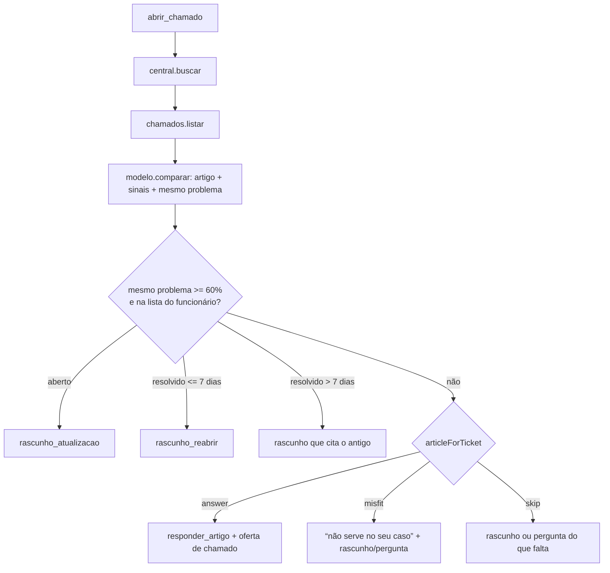

# Precisão do agent - Design

**Spec**: `.specs/features/precisao-do-agent/spec.md`
**Status**: Approved (com as tasks, 2026-10-29)

---

## Architecture Overview

O modelo continua só lendo; o motor decide. Três mudanças no caminho de abrir chamado e duas nos prompts:

1. O juiz (`modelo.comparar`) passa a devolver dois sinais a mais sobre o artigo: `articleResolves` (o artigo resolve este sintoma sem chamado) e `articleTried` (a pessoa diz que já fez o passo do artigo). Ele recebe também o corpo do artigo, sem o qual não dá para saber se o passo já foi tentado.
2. Uma regra pura nova, `rules/article.ts`, combina os sinais e decide: responder com o artigo, dizer que ele não serve, ou seguir para o chamado.
3. `startTicket` decide a duplicidade **antes** do artigo: achado um chamado do mesmo problema, segue a regra de duplicidade e o artigo nem é considerado.
4. `fieldsFrom` deriva `blocksWork = false` de `workaround = true` quando o modelo não disse se impede.
5. O prompt de entendimento ganha as definições e exemplos de `affected`, `workaround` e de relato vago.

As chamadas de ferramenta não mudam de ordem nem de número (`central.buscar` → `chamados.listar` → `modelo.comparar`, uma chamada ao juiz): muda só a ordem das decisões depois do juiz. O fluxo de `duvida` (`helpCenter`) não muda (PRE-12).



### Regra do artigo ao abrir chamado (`articleForTicket`)

| Artigo apontado está na busca? | `articleResolves` | `articleTried` | `articleFits` | Decisão |
| --- | --- | --- | --- | --- |
| não | - | - | - | skip |
| sim | `false` ou `null` | - | - | skip (PRE-07) |
| sim | `true` | `true` | - | skip (PRE-08) |
| sim | `true` | `false`/`null` | `false` | misfit (PRE-10) |
| sim | `true` | `false`/`null` | `true`/`null` | answer (PRE-06) |

`null` em `articleResolves` conta como "não resolve" (spec, "Sinal ausente do juiz"). `null` em `articleTried` conta como "não tentou": a pessoa só tentou se disse. `articleFits` `null` mantém o default de hoje (serve).

---

## Code Reuse Analysis

### Existing Components to Leverage

| Component | Location | How to Use |
| --- | --- | --- |
| `duplicateAction` | `packages/agent/src/rules/duplicates.ts` | Sem mudança; passa a ser chamado antes da decisão do artigo. |
| `answerWithArticle`, `continueDraft` | `packages/agent/src/engine.ts` | Reusados pelo novo `startTicket`. |
| `createScriptedUnderstander`, `agentHarness` | `src/understand-scripted.ts`, `src/testing.ts` | Testes do motor com juiz roteirizado; `emptyJudgement` ganha os dois campos `null`. |
| `MockLanguageModelV4` | `ai/test` | Testa o prompt enviado ao juiz e ao entendimento em `understand-mastra.test.ts`. |
| `runEval`, `CONVERSATIONS` | `packages/agent/eval/run.ts`, `eval/conversations.ts` | `runEval` recebe a lista filtrada; `conversations.ts` não muda. |
| Padrão das regras puras | `src/rules/*.ts` + `rules.test.ts` | `article.ts` segue o mesmo formato (função pura, teste por linha da tabela). |

### Integration Points

| System | Integration Method |
| --- | --- |
| `apps/server/src/dev-understander.ts` | Devolve `emptyJudgement()`; os campos novos chegam `null` sem mudar o arquivo. |
| Painel "Por que o Nexo fez isso" | `describeModel` mostra "não resolve" ou "já tentou" no resultado de `modelo.comparar` (observabilidade da spec); nenhum passo novo, então a linha de ação do front não muda. |
| `scripts/docs.test.ts` | Já confere total e custo do RESULT.md no README; ganha a conferência das regras abaixo de 100%. |

---

## Components

### Seleção de conversas da avaliação

- **Purpose**: Rodar só as conversas pedidas em `--only`, sem gravar o RESULT.md.
- **Location**: `packages/agent/eval/run.ts`, `packages/agent/eval/cli.ts`
- **Interfaces**:
  - `selectConversations(only: string[] | null): { ok: true; conversations: EvalConversation[] } | { ok: false; unknown: string[] }` - `null` devolve as 22; ids repetidos rodam uma vez; id desconhecido falha.
  - `onlyArg(argv: string[]): string[] | null` - lê `--only a,b` (ou `--only=a,b`).
  - `runEval(understander?, { pauseMs, sleep, conversations })` - `conversations` default `CONVERSATIONS`; `report.conversations` é o tamanho da lista rodada.
  - `cli.ts`: id desconhecido → mensagem com o id, `exit(1)`, antes de criar o modelo; com `--only` não grava RESULT.md e diz isso na saída.
- **Reuses**: `runEval` de hoje.

### Regra do artigo ao abrir chamado

- **Purpose**: Decidir, a partir dos sinais do juiz, se o artigo responde ao pedido de chamado.
- **Location**: `packages/agent/src/rules/article.ts`
- **Interfaces**:
  - `articleForTicket(signals: ArticleSignals, articles: Article[]): { kind: "answer"; article } | { kind: "misfit"; article } | { kind: "skip" }`
  - `ArticleSignals = Pick<Judgement, "articleSlug" | "articleFits" | "articleResolves" | "articleTried">`
- **Reuses**: tipo `Article` de `@nexo-assist/tickets`.

### Sinais do juiz

- **Purpose**: O juiz devolve `articleResolves` e `articleTried`, lê o corpo do artigo e recebe a definição de "resolve sem chamado" com exemplos (PRE-11).
- **Location**: `packages/agent/src/understand.ts` (schema, `emptyJudgement`), `packages/agent/src/understand-mastra.ts` (`JUDGE_INSTRUCTIONS`, prompt com `body`)
- **Interfaces**: `JudgementSchema` += `articleResolves: boolean | null`, `articleTried: boolean | null`.

### `startTicket` e `fieldsFrom`

- **Purpose**: Duplicidade antes do artigo (PRE-05, PRE-09); artigo pela regra nova (PRE-06 a PRE-08, PRE-10); `workaround` true sem `blocksWork` vira não impede (PRE-13).
- **Location**: `packages/agent/src/engine.ts`
- **Reuses**: `duplicateAction`, `articleForTicket`, `answerWithArticle`, `continueDraft`.

### Prompt de entendimento

- **Purpose**: `affected` só quando dito (ou equipamento/acesso para si); "outro jeito de trabalhar" = `workaround` true e `blocksWork` false; `outro` só para saudação e mensagem sem pedido nem problema; relato vago de problema = `abrir_chamado` com confiança abaixo de 60 (PRE-14 a PRE-16).
- **Location**: `packages/agent/src/understand-mastra.ts` (`UNDERSTAND_INSTRUCTIONS`, exportado para teste)

### Resultado registrado

- **Purpose**: Gravar a rodada completa final e provar a meta a partir do arquivo, sem chamar o modelo de novo.
- **Location**: `packages/agent/eval/RESULT.md` (gerado), `README.md`, `packages/agent/eval/result.test.ts` (novo), `scripts/docs.test.ts`
- **Interfaces**: `result.test.ts` lê o RESULT.md e confere: total ≥ 90% (PRE-18), as 9 regras que estavam em 100% continuam em 100% (PRE-20), nenhuma linha de erro de `confianca-baixa` (PRE-17), 22 conversas.

---

## Data Models

```typescript
// understand.ts
export const JudgementSchema = z.object({
	articleSlug: z.string().nullable(),
	articleFits: z.boolean().nullable(),
	articleMisfitReason: z.string().nullable(),
	/** O artigo resolve este sintoma sem chamado (não só explica como pedir). */
	articleResolves: z.boolean().nullable(),
	/** A pessoa diz que já fez o passo do artigo. */
	articleTried: z.boolean().nullable(),
	sameProblemNumber: z.string().nullable(),
	sameProblemConfidence: score,
});
```

---

## Error Handling Strategy

| Error Scenario | Handling | User Impact |
| --- | --- | --- |
| Juiz não devolve `articleResolves` | Conta como não resolve; segue para o chamado. | Rascunho em vez de artigo. |
| Juiz aponta artigo fora da busca | `articleForTicket` devolve skip. | Rascunho, como hoje. |
| Juiz aponta chamado fora da lista | `duplicateAction` devolve `new`; segue para o artigo. | Como hoje. |
| `--only` com id desconhecido | Sai com 1 e cita o id, sem criar o modelo. | Nenhuma chamada gasta. |
| Modelo falha ou estoura cota em rodada parcial | Como hoje (AGT-47); com `--only` não grava RESULT.md. | Erro mostrado na conversa. |

---

## Risks & Concerns

| Concern | Location (file:line) | Impact | Mitigation |
| --- | --- | --- | --- |
| `engine.ts` tem 1.608 linhas e `startTicket` mistura busca, julgamento, duplicidade e montagem | `packages/agent/src/engine.ts:739` | Mudar a ordem pode quebrar complementar/reabrir. | A decisão do artigo sai para `rules/article.ts` (pura, testada por linha); os testes de duplicidade existentes (`engine.create.test.ts`, avaliação roteirizada) seguem como rede. |
| Variação do modelo entre rodadas | avaliação ao vivo | Uma rodada parcial boa não garante a completa. | Rodadas parciais nas conversas com erro mais controles das regras em 100%; meta vale para a rodada final (spec). |
| Prompt maior custa tokens | `understand-mastra.ts` | Custo por conversa sobe um pouco. | Exemplos curtos; o custo vai para o README pela rodada final. |
| `result.test.ts` prende a suíte ao RESULT.md gravado | `packages/agent/eval/result.test.ts` | Uma rodada futura abaixo de 90% gravada no arquivo deixa a suíte vermelha. | É a intenção: o RESULT.md commitado é a prova da meta; quem grava rodada pior vê a regressão. |
| Sem teste que cubra os prompts de verdade | prompts | Um teste de texto do prompt prova que a regra está escrita, não que o modelo obedece. | O efeito é medido pelas rodadas parciais e pela completa, registradas no RESULT.md e provadas por `result.test.ts`. |

---

## Tech Decisions

| Decision | Choice | Rationale |
| --- | --- | --- |
| Onde mora a escolha do artigo | Regra pura `rules/article.ts` | Regras em código testado (spec do agent); testa as 5 linhas da tabela sem banco. |
| Sinais novos no mesmo juiz | Dois campos no `JudgementSchema`, uma chamada só | Uma chamada a mais por conversa estouraria a cota; o juiz já vê artigos e chamados juntos. |
| Corpo do artigo no prompt do juiz | Manda `body` | Sem o passo, o juiz não sabe se a pessoa já o tentou ("o autoatendimento não libera"). |
| Prova de PRE-17, PRE-18 e PRE-20 | Teste que lê o RESULT.md da rodada final | `check_proofs.py` roda as provas no fim; uma prova ao vivo gastaria cota a cada execução. |
| Passo novo no registro de decisão | Nenhum; `describeModel` mostra os sinais | Um passo novo mudaria a linha de ação do front e testes que conferem a lista de ferramentas. |

Nenhuma decisão de projeto nova: tudo é local à feature e conforme AD-007 (limiar 60%), AD-008/AD-023 (modelo e cota) e AD-021 (Mastra).
