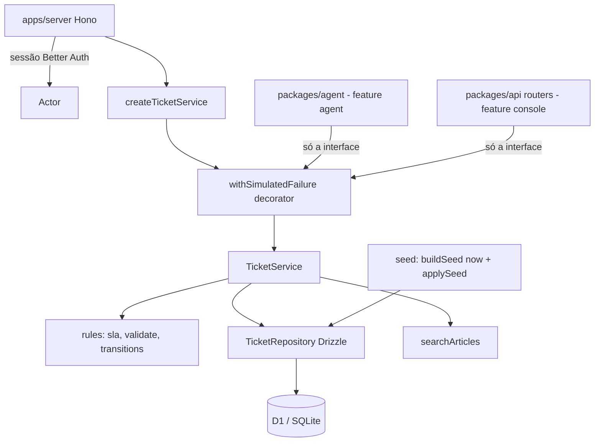

# Serviço de chamados Design

**Spec**: `.specs/features/servico-de-chamados/spec.md`
**Status**: Approved
**Approved**: 2026-10-28 - user: "Aprovo D-01 a D-05 e E-01 a E-03 como recomendado (abordagem A, libsql + smoke D1, tabela profile, ranking em código, db:seed, dev local sem login, Flash-Lite, commitar a migração); pode gerar as tasks"

> Abordagem A e decisões D-01 a D-05 aprovadas em 2026-10-28 (AD-013, AD-014, AD-015). Nada implementado ainda.

---

## Approaches (Large: confirmar antes de detalhar)

As três entregam o mesmo escopo (TKT-01 a TKT-33).

### A. Pacote `packages/tickets` no mesmo Worker, atrás de uma interface (recomendada)

Um pacote novo com três camadas: regras puras (prazo, validação, transições), um repositório Drizzle sobre o D1 que a base já tem, e um `TicketService` que é a única porta de entrada. A falha simulada é um decorator em volta do serviço. O agent recebe um `TicketService` pronto e não importa nada além do tipo.

- **Prós**: usa o D1, o Drizzle e as migrações da base sem infraestrutura nova; tudo testável com `bun test` sem rede; a separação fica no código e nas dependências do pacote, que o lint e o `tsc` podem conferir; um único `dev` local.
- **Contras**: o "legado" roda no mesmo processo; a separação é de módulo, não de rede. O README precisa justificar (DLV-06).

### B. Worker separado ligado por service binding

O mesmo pacote de A, publicado como um segundo Worker (`tickets`) com seu próprio D1, chamado pelo Worker do servidor via service binding RPC.

- **Prós**: separação física, mais parecida com um legado real; a indisponibilidade pode ser de rede de verdade.
- **Contras**: mais um recurso no `alchemy.run.ts`, mais um processo no dev local (que já tem o problema de AD-012), dois bancos e dois conjuntos de migrações, testes de integração mais pesados. O PDF pede separação do agent, não outro processo.

### C. Servidor HTTP de mock (Hono) com estado em arquivo ou SQLite local

Um app à parte (`apps/tickets-mock`) com rotas REST, rodando com Bun.

- **Prós**: simples de entender, contrato HTTP explícito.
- **Contras**: não roda no Cloudflare como o resto, então o deploy (AD-010) precisaria de outro lugar; duplica persistência fora do D1; mais um comando para subir.

**Recomendação: A.** Entrega a separação que o PDF pede com o menor custo, deixa o deploy em um Worker só e mantém o dev local em um comando. Se o André quiser a separação física, A evolui para B sem reescrever: o pacote é o mesmo, muda só onde ele é instanciado.

---

## Architecture Overview

O serviço vive em `packages/tickets`. O servidor Hono monta o `TicketService` por requisição com o banco e o relógio, e o entrega ao agent (feature `agent`) e aos routers tRPC do console (feature `console-analista`). Quem chama passa um `Actor` montado da sessão do Better Auth, nunca do modelo (TKT-06).



---

## Code Reuse Analysis

### Existing Components to Leverage

| Component | Location | How to Use |
| --- | --- | --- |
| `createDb` (Drizzle D1 com relations) | `packages/db/src/index.ts:6` | Instância do banco passada ao repositório. |
| Schema e migrações Drizzle | `packages/db/src/schema/index.ts`, `packages/db/drizzle.config.ts` | Novas tabelas em `packages/db/src/schema/tickets.ts`, exportadas pelo índice; migração gerada por `bun run db:generate`. |
| Tabela `user` do Better Auth | `packages/db/src/schema/auth.ts:4` | Funcionários e analistas são `user`; o perfil fica numa tabela 1:1 (`profile`) para não tocar o schema do Better Auth. |
| D1 do `alchemy.run.ts` | `packages/infra/alchemy.run.ts:8` | Já aplica `packages/db/src/migrations` no D1; as tabelas novas entram por ali. |
| Contexto tRPC com `session` e `db` | `packages/api/src/context.ts`, `apps/server/src/context.ts` | Fonte do `Actor` e do banco. |
| `protectedProcedure` | `packages/api/src/index.ts` | Base dos procedures do console (fora desta feature). |
| `@libsql/client` / `libsql` | `packages/db/package.json` | Já são dependências: SQLite em memória para os testes do repositório, sem instalar nada novo. |

### Integration Points

| System | Integration Method |
| --- | --- |
| Feature `agent` | Ferramentas do Mastra recebem um `TicketService` e o `Actor` da conversa por closure; nunca recebem `requesterId` do modelo. |
| Feature `console-analista` | Routers tRPC chamam o mesmo `TicketService` com `Actor` de analista. |
| Feature `acesso` | Usa os `user` e `profile` criados pelo seed; o papel vem de `profile.role`. |
| Feature `entrega` | Script de seed e o caminho de dev local (AD-012). |

---

## Components

### Regras puras (`packages/tickets/src/rules/`)

- **Purpose**: tudo que muda o que o usuário vê sem tocar no banco: prazo, horário útil, vencimento, validação, transições de status, janela de reabertura.
- **Location**: `sla.ts`, `business-hours.ts`, `validate.ts`, `transitions.ts`.
- **Interfaces**:
  - `addBusinessMinutes(start: Date, minutes: number): Date` - pula noites e fins de semana em America/Sao_Paulo (TKT-18).
  - `deadlineFor(priority: Priority, anchor: Date): Date` - Crítica soma 60 minutos corridos; as outras somam 240, 1.800 e 3.000 minutos úteis (TKT-17).
  - `overdue(ticket, now): { vencido: boolean; atrasoMinutos: number }` - atraso em minutos úteis, ou corridos na Crítica (TKT-19).
  - `validateNewTicket(input): Result<NewTicket, TicketError>` - campos, listas e limites 120/4.000 (TKT-08 a TKT-10).
  - `canUpdate(status)`, `canReopen(ticket, now)` (TKT-14 a TKT-16).
- **Dependencies**: nenhuma; o relógio entra por parâmetro.
- **Reuses**: nada; é código novo e 100% coberto por testes de unidade com relógio fixo.

### `TicketRepository` (`packages/tickets/src/repository.ts`)

- **Purpose**: leitura e escrita no D1 via Drizzle.
- **Location**: `packages/tickets/src/repository.ts`.
- **Interfaces**: `listByRequester`, `listAll`, `getByNumber`, `insertTicket` (numeração atômica e chave de idempotência), `addNote`, `addEvent`, `updateStatus`, `searchArticleCandidates`.
- **Dependencies**: `Database` de `@nexo-assist/db`.
- **Reuses**: `createDb`, schema Drizzle da base.
- **Notas**: o D1 não tem transação interativa. A criação usa `db.batch`, que o D1 executa em sequência e desfaz inteiro se um comando falhar: `UPDATE ticket_counter SET value = value + 1 WHERE type = ?` e, no mesmo lote, o `INSERT` do chamado com o número lido por subconsulta de `ticket_counter` e a chave de idempotência sob índice único. Se a chave colidir, o lote todo volta, inclusive o contador. Uma segunda chamada com a mesma chave lê o chamado existente antes de alocar número (TKT-12, edge case de concorrência).

### `TicketService` (`packages/tickets/src/service.ts`)

- **Purpose**: a interface pública do "legado" (TKT-01).
- **Location**: `packages/tickets/src/service.ts`; tipos em `packages/tickets/src/types.ts`.
- **Interfaces**:

```ts
export interface TicketService {
  list(actor: Actor, opts?: { onlyOpen?: boolean; requesterId?: string }): Promise<Result<TicketSummary[]>>;
  get(actor: Actor, number: string): Promise<Result<TicketDetail>>;
  create(actor: Actor, input: NewTicketInput, idempotencyKey: string): Promise<Result<TicketDetail>>;
  addNote(actor: Actor, number: string, body: string): Promise<Result<TicketDetail>>;
  reopen(actor: Actor, number: string, reason: string): Promise<Result<TicketDetail>>;
  transfer(actor: Actor, number: string, t: { summary: string; team: Team }): Promise<Result<TicketDetail>>;
  assume(actor: AnalystActor, number: string): Promise<Result<TicketDetail>>;
  searchArticles(query: string): Promise<Result<Article[]>>;
}
```

- **Dependencies**: `TicketRepository`, regras puras, `Clock`.
- **Reuses**: nada.
- **Privacidade**: `list` e `get` com `Actor` de funcionário filtram por `requester_id = actor.userId`; chamado de outro devolve `NOT_FOUND`, igual ao inexistente (TKT-05). `requesterId` em `opts` só vale para analista (TKT-07).

### `withSimulatedFailure` (`packages/tickets/src/failure.ts`)

- **Purpose**: sortear `SERVICE_UNAVAILABLE` antes de chamar o serviço real, então nada é gravado (TKT-25, TKT-26).
- **Interfaces**: `withSimulatedFailure(service, { rate: number; extraLatencyMs?: number; random?: () => number }): TicketService`.
- **Dependencies**: env `TICKETS_FAILURE_RATE` (padrão 0,1) e `TICKETS_EXTRA_LATENCY_MS` (padrão 0), lidas no servidor.
- **Reuses**: varlock da base para declarar as variáveis.

### Busca na central (`packages/tickets/src/kb.ts`)

- **Purpose**: até 3 artigos por relevância (TKT-31, TKT-32).
- **Interfaces**: `rankArticles(query: string, articles: Article[]): Article[]`.
- **Como**: normaliza (minúsculas, sem acento), tokeniza, pontua termo no título ×2, no texto ×1 e nas palavras-chave ×3; corta abaixo de uma pontuação mínima. Puro e testado. Os artigos são poucos (5 a 10), então lê todos e ranqueia em memória.

### Seed (`packages/tickets/src/seed/`)

- **Purpose**: Anexo B com datas relativas ao momento do seed (TKT-28 a TKT-30, TKT-33).
- **Interfaces**: `buildSeed(now: Date): SeedData` (puro, testável) e `applySeed(db, data)` com upsert por chave natural (e-mail, número, slug), então rodar duas vezes não duplica.
- **Como roda**: `bun run db:seed`. O comando exato depende do caminho de dev local de AD-012 (ver D-05).

---

## Data Models

```ts
export type TicketType = "INC" | "REQ";
export type Category = "Acesso" | "Rede e VPN" | "Hardware" | "Software" | "E-mail" | "Outros";
export type Priority = "Crítica" | "Alta" | "Média" | "Baixa";
export type Affected = "Só eu" | "Minha equipe" | "Toda a empresa";
export type Status =
  | "Aguardando analista" | "Em andamento" | "Em atendimento"
  | "Aprovado" | "Resolvido" | "Fechado" | "Cancelado";
export type Team = "Suporte N1" | "Suporte N2";

export type Actor =
  | { kind: "employee"; userId: string }
  | { kind: "analyst"; userId: string; name: string; team: Team };
export type AnalystActor = Extract<Actor, { kind: "analyst" }>;

export type TicketErrorCode =
  | "NOT_FOUND" | "INVALID_TICKET" | "TICKET_CLOSED"
  | "REOPEN_NOT_ALLOWED" | "INVALID_TRANSFER" | "SERVICE_UNAVAILABLE";
export type TicketError = { code: TicketErrorCode; message: string; fields?: string[] };
export type Result<T> = { ok: true; value: T } | { ok: false; error: TicketError };

export interface TicketSummary {
  number: string;            // INC-20311
  title: string;
  type: TicketType;
  category: Category;
  item: string | null;       // "Notebook" em "Hardware › Notebook"
  priority: Priority;
  status: Status;
  openedAt: Date;
  updatedAt: Date;
  deadlineAt: Date;          // calculado na leitura, nunca gravado
  vencido: boolean;
  atrasoMinutos: number;
}

export interface TicketDetail extends TicketSummary {
  description: string;
  affected: Affected;
  requester: { id: string; name: string };
  notes: { author: string; body: string; at: Date }[];
  events: { kind: "criado" | "transferido" | "assumido" | "atualizado" | "reaberto" | "resolvido";
            actor: string; summary?: string; team?: Team; at: Date }[];
}

export interface Article { slug: string; title: string; body: string; appliesWhen: string; keywords: string[] }
```

Tabelas novas (Drizzle, SQLite/D1), em `packages/db/src/schema/tickets.ts`:

| Tabela | Colunas principais | Índices |
| --- | --- | --- |
| `profile` | `user_id` (PK, FK `user.id`), `role` (`employee`/`analyst`), `department`, `os`, `team`, `password_changed_at` | - |
| `ticket` | `id`, `number`, `type`, `title`, `description`, `category`, `item`, `priority`, `affected`, `status`, `requester_id`, `assignee_id`, `opened_at`, `updated_at`, `sla_anchor_at`, `resolved_at`, `idempotency_key` | único `number`; único `idempotency_key`; `requester_id, updated_at` |
| `ticket_note` | `id`, `ticket_id`, `author_id`, `body`, `created_at` | `ticket_id` |
| `ticket_event` | `id`, `ticket_id`, `kind`, `actor_id`, `summary`, `team`, `created_at` | `ticket_id` |
| `ticket_counter` | `type` (PK), `value` | - |
| `kb_article` | `slug` (PK), `title`, `body`, `applies_when`, `keywords` (JSON) | - |

`sla_anchor_at` guarda a última atualização da equipe; o prazo sai de `deadlineFor(priority, sla_anchor_at)` em cada leitura, então não fica desatualizado (TKT-20, TKT-21).

---

## Error Handling Strategy

| Error Scenario | Handling | User Impact |
| --- | --- | --- |
| Sorteio de indisponibilidade | `SERVICE_UNAVAILABLE` antes de qualquer leitura ou gravação. | O agent tenta de novo (AGT-43) com a mesma chave. |
| Campo ausente ou fora da lista, título/descrição longos | `INVALID_TICKET` com `fields`. Nada gravado. | O agent pede o dado que falta. |
| Chamado inexistente ou de outro funcionário | `NOT_FOUND`, mesma mensagem nos dois casos. | Sem vazar existência de chamado alheio. |
| Nota em chamado Resolvido, Fechado ou Cancelado | `TICKET_CLOSED`. | O agent oferece reabrir ou abrir outro. |
| Reabrir fora da janela de 7 dias ou fora de Resolvido | `REOPEN_NOT_ALLOWED`. | O agent abre um chamado novo citando o antigo. |
| Transferência sem resumo | `INVALID_TRANSFER`. | Erro de programação do agent; aparece nos testes. |
| Mesma chave de idempotência | Devolve o chamado já criado. | Sem duplicata. |
| Erro inesperado do D1 | Exceção sobe como `SERVICE_UNAVAILABLE` e é logada com o código interno. | Mesmo caminho de retentativa. |

Erros de regra são valores (`Result`), não exceções, para o agent e o console tratarem cada código sem `try/catch` espalhado.

---

## Risks & Concerns

| Concern | Location | Impact | Mitigation |
| --- | --- | --- | --- |
| Dev local depende do state store remoto da Cloudflare | `packages/infra/alchemy.run.ts:33` (`state: Cloudflare.state()`) | O avaliador sem conta não roda `alchemy dev`; migrações e seed locais dependem disso. | AD-012; caminho local decidido em `entrega` (ver D-05). Os testes desta feature não dependem dele. |
| `alchemy dev` falhou ao subir o web | `.alchemy/log/dev_andre/2026-10-28T17-48-44.115Z.log` (`ERR_MODULE_NOT_FOUND ... register-dev-mode.js`, alchemy 2.0.0-beta.84) | O `bun run dev` da base não sobe o front hoje. | Fora desta feature; registrar em `entrega`. |
| Migração da base não versionada | `packages/db/src/migrations/20261028174751_flat_lockheed/` (untracked no git) | A migração das tabelas novas fica empilhada sobre uma que não está no histórico. | Commitar a migração da base antes da primeira tarefa, ou regenerar; pedir ao André. |
| D1 sem transação interativa | `packages/db/src/index.ts:6` (`drizzle-orm/d1`) | Numeração e idempotência não podem usar `BEGIN ... COMMIT`. | `db.batch` + contador por subconsulta + índice único (ver `TicketRepository`). |
| Testes em libsql podem esconder diferenças do D1 | `packages/db/package.json` (`@libsql/client`) | Um comportamento passa em memória e falha no D1. | Um teste de fumaça contra D1 local (miniflare) quando o caminho de AD-012 existir. |
| Schema do Better Auth é gerado | `packages/db/src/schema/auth.ts:4` | Colunas novas em `user` seriam sobrescritas ao regenerar. | Perfil em tabela própria `profile`. |
| Cadastro aberto na base | `packages/auth/src/index.ts:23` (`emailAndPassword: { enabled: true }`) | Qualquer um criaria usuário fora do seed. | Tratado no Design de `acesso` (AD-006). |
| Sem test runner nem script `test` | `package.json` (raiz, sem `test`) | DLV-09 pede `bun test`. | Adicionar `test` no pacote e na raiz via Turborepo (ver D-02). |
| Fuso America/Sao_Paulo no Worker | `packages/tickets/src/rules/business-hours.ts` (novo) | Erro de fuso muda todos os prazos. | Converter com `Intl.DateTimeFormat` e `timeZone`, testar os exemplos da spec e uma virada de dia em UTC. |

---

## Tech Decisions

| Decision | Choice | Rationale |
| --- | --- | --- |
| Onde o serviço roda | Pacote `packages/tickets` no Worker do servidor (abordagem A, AD-013) | Menor custo com a separação pedida. |
| Formato de erro | `Result<T>` com `TicketErrorCode` | Cada código vira um caminho explícito no agent e no console. |
| Prazo | Calculado na leitura a partir de `sla_anchor_at` | Sempre correto sem job de atualização. |
| Relógio e aleatoriedade | Injetados (`Clock`, `random`) | Testes determinísticos (TKT-26, exemplos de TKT-17). |
| Busca na central | Ranking em código, em memória | 5 a 10 artigos; determinístico e testável; sem FTS nem embeddings. |
| Testes | `bun test`; regras puras com relógio fixo; repositório em SQLite em memória (libsql) | Sem instalar nada novo (AD-014). |

A abordagem, os testes, o perfil, a busca e o seed viraram AD-013 a AD-015.

---

## Decisões do André (aprovadas em 2026-10-28)

| ID | Pergunta | Recomendação (aprovada) |
| --- | --- | --- |
| D-01 | Abordagem: A (pacote no mesmo Worker), B (Worker separado com service binding) ou C (servidor HTTP de mock)? | A. |
| D-02 | Testes do repositório: SQLite em memória (libsql, já dependência de `packages/db`) ou D1 local via miniflare? | libsql em memória para o dia a dia, mais um teste de fumaça no D1 local quando AD-012 estiver resolvido. |
| D-03 | Funcionários e analistas: tabela `profile` 1:1 com `user` do Better Auth, ou colunas extras em `user`? | `profile`, para não mexer no schema gerado do Better Auth. |
| D-04 | Busca na central: ranking em código, FTS5 do SQLite ou embeddings? | Ranking em código. |
| D-05 | Como o seed roda localmente: script `bun run db:seed` contra o D1 local, ou seed automático na primeira requisição com banco vazio? | Script `bun run db:seed`, chamado pelo comando de dev; o comando exato sai com o caminho local de AD-012 no Design de `entrega`. |
