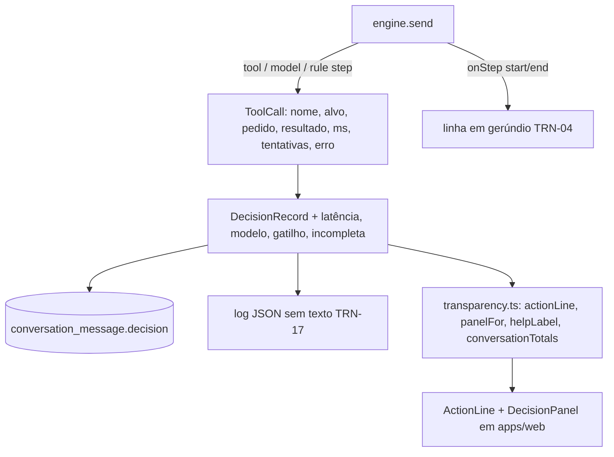

# Transparência Design

**Spec**: `.specs/features/transparencia/spec.md`
**Status**: Approved
**Approved**: 2026-10-28 - user: "sim, faça a aplicação de todas as features, me avise se precisar de algo" (delegado por André em t152u; abordagem A e D-01 a D-04 recomendadas adotadas, AD-020)

---

## Approaches

### A. Passos registrados pelo motor + apresentador puro (recomendada)

O motor do `agent` grava cada passo executado (ferramenta do serviço, chamada ao modelo e passo de regra em código) no `DecisionRecord`, com pedido e resultado resumidos, duração, tentativas e erro. Um módulo puro (`packages/agent/src/transparency.ts`) traduz o registro em rótulos e no painel. A web só desenha o que o apresentador devolve.

- **Prós**: TRN-02 vale por construção (rótulo só sai de passo gravado); o mesmo apresentador serve chat e console (TRN-14); testável sem navegador.
- **Contras**: o registro fica maior (alguns KB por resposta).

### B. Rótulos escritos pelo modelo

- **Contras**: o modelo pode anunciar ações que não aconteceram, que é o que o spec proíbe.

### C. Reconstruir os rótulos a partir dos blocos da resposta

- **Contras**: "classificou a prioridade" e "consultou o SLA" não deixam bloco próprio; falha de ferramenta não aparece.

**Recomendação: A** (adotada).

---

## Architecture Overview

## Code Reuse Analysis

| Component | Location | How to Use |
| --- | --- | --- |
| `DecisionRecord`, `ToolCall` | `packages/agent/src/types.ts` | Ganham campos opcionais (registros antigos continuam válidos) |
| `tool()`, `model()`, `finish()` | `packages/agent/src/engine.ts` | Medem e resumem cada passo |
| `agentHarness` | `packages/agent/src/testing.ts` | Testes de integração dos passos |
| `Sheet` / estilos | `packages/ui`, `apps/web/src/index.css` | Painel lateral |

## Components

### Passos no motor (`engine.ts`)

- `ToolCall = { name, ok, attempts, target?, request?, result?, error?, durationMs? }`.
- Nomes: `chamados.listar`, `chamados.consultar`, `central.buscar`, `chamados.criar`, `chamados.complementar`, `chamados.reabrir`, `chamados.transferir`, `conversa.transferir` (sem chamado), `modelo.entender`, `modelo.comparar`, e os passos de regra `regra.prioridade`, `regra.sla`, `rascunho.montar`, `regra.prazo`.
- `DecisionRecord` ganha `latencyMs`, `model`, `transfer?: { trigger: "pedido" | "critica" | "vencido" | "confianca_baixa"; summary }` e `incomplete?`.
- `AgentDeps.onStep?(event)` com `{ conversationId, name, target, phase: "start" | "end", ok? }` para a linha em gerúndio; `AgentDeps.log?(line)` para o log JSON; `AgentDeps.modelId?`.

### Apresentador (`transparency.ts`)

- `STEP_LABELS`: catálogo fixo nome → `{ done, doing, failed }` (TRN-02, TRN-03, TRN-04). Passos do modelo não aparecem na linha, só no painel.
- `actionLine(decision)` → `{ label, ok }[]`, na ordem e sem repetir; vazio vira "respondeu sem consultar sistemas" (TRN-05).
- `progressLabel(name, target)` → gerúndio com "…".
- `panelFor(decision, audience)` → `{ understood, did, confidence: { pct, band }, why, steps, transfer?, cost? }`; `audience = "employee" | "analyst"`: funcionário vê só o tempo, analista vê modelo, tokens e custo (TRN-14); campos ausentes somem (edge case).
- `helpLabel(decision)` → "Agent pediu ajuda · confiança NN%" (TRN-15).
- `conversationTotals(decisions)` → tokens e custo somados (TRN-18).
- `decisionLog(ids, decision)` → objeto do log, sem texto de mensagem nem pedido/resultado (TRN-17).

### Web (`apps/web/src/features/decision/`)

- `ActionLine`: "Nexo Assist" + rótulos com ✓/✕; botão que abre o painel (TRN-01, TRN-06). Em andamento, mostra o gerúndio.
- `DecisionPanel`: painel lateral "Por que o Nexo fez isso", fecha no X e no Esc; seções "O que entendi", "O que fiz", "Confiança", "Por quê", "Passos", "Transferência", "Custo" (analista).
- Telas: a linha e o painel aparecem nas capturas 02 e 03 (`chat-funcionario`) e 04 (`console-analista`); a conferência visual fica nessas features, que montam as telas.

## Error Handling Strategy

| Error Scenario | Handling | User Impact |
| --- | --- | --- |
| Ferramenta falha depois das tentativas | Passo com `ok: false` e `error` | "✕ não conseguiu consultar seus chamados" |
| Modelo falha no meio | Registro com `incomplete: true` e os passos já feitos | Painel mostra "Resposta incompleta" |
| Registro antigo sem campo novo | Apresentador omite a seção | Nada quebra |

## Tech Decisions

| Decision | Choice | Rationale |
| --- | --- | --- |
| Onde mora o apresentador | `packages/agent/src/transparency.ts`, só tipos importados | Chat e console usam o mesmo; a web não puxa o Mastra |
| Confiança | alta ≥ 80, média 60 a 79, baixa < 60 | Spec (Assumptions) |
| "Por quê" | `reason` + regra, cortado em 3 frases | TRN-10 |
