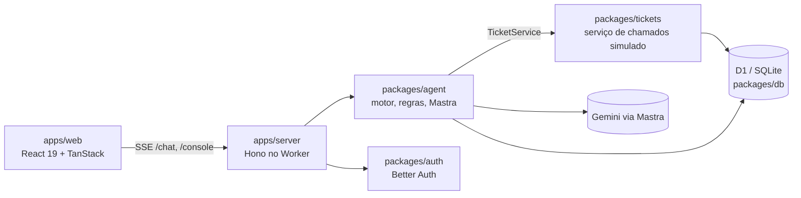

# Nexo Assist

Agent de atendimento do service desk de TI da Nexo. O funcionário descreve o problema num chat; o agent consulta os chamados dele, busca na central de ajuda, abre ou atualiza chamados e chama um analista quando precisa. Cada resposta mostra o que o agent fez e por quê. O analista acompanha tudo num console, assume a conversa com o agent pausado e devolve ou encerra.

Desafio técnico da Beyond the Bytes. Requisitos em `.specs/source/desafio-prd.md`; specs, decisões e provas de cada feature em `.specs/`.

## Como rodar

Precisa do [Bun](https://bun.sh) 1.4 ou mais novo. Não precisa de conta Cloudflare: o dev local usa o estado local do Alchemy e um D1 em miniflare.

```bash
bun install
bun run setup   # cria apps/server/.env e apps/web/.env a partir dos .env.example e gera o BETTER_AUTH_SECRET
bun run dev     # sobe servidor (:3000) e web (:3001), aplica as migrações do D1 e carrega o seed
```

Abra http://localhost:3001 e entre com um e-mail do seed. Qualquer senha não vazia serve:

| E-mail                                                                                                      | Papel                                 |
| ----------------------------------------------------------------------------------------------------------- | ------------------------------------- |
| `ana.souza@nexo.com.br`                                                                                     | funcionária (Financeiro)              |
| `bruno.costa@nexo.com.br`, `carla.mendes@nexo.com.br`, `diego.alves@nexo.com.br`, `elisa.rocha@nexo.com.br` | funcionários                          |
| `rafael.lima@nexo.com.br`                                                                                   | analista, Suporte N2 (abre o console) |
| `marina.teixeira@nexo.com.br`                                                                               | analista, Suporte N1                  |

**Chave do modelo (opcional para rodar, necessária para o agent de verdade).** Crie uma chave em https://aistudio.google.com/apikey e coloque em `GOOGLE_GENERATIVE_AI_API_KEY` no `apps/server/.env`. O modelo vem de `LLM_MODEL` (padrão `google/gemini-3.5-flash-lite`); trocar de modelo ou de provedor é trocar essa variável e a chave. Sem chave, o dev local entende as mensagens por palavras-chave, o suficiente para andar pelas telas.

O free tier do Google AI Studio tem limites por projeto, não por chave, e eles são baixos para um agent que faz várias chamadas por conversa: em rajada, aparece "Limite de uso atingido" e o agent espera e tenta uma vez (AGT-47). No free tier, o Google pode usar prompts e respostas para melhorar seus produtos, e revisores humanos podem lê-los. Por isso o seed usa só dados fictícios.

Outros comandos:

```bash
bun run test          # todos os testes (bun test em cada pacote)
bun test scripts      # testes dos scripts da raiz (setup, dev, varredura de chaves, README)
bun run check-types   # TypeScript strict em todo o monorepo
bun run check         # Biome (lint e formatação)
bun run eval          # avaliação do agent com o entendimento roteirizado
bun run eval --live   # avaliação com o Gemini (lê a chave de apps/server/.env); grava packages/agent/eval/RESULT.md
bun run db:seed       # recarrega o seed (idempotente) com o dev no ar
```

## Arquitetura



Monorepo Bun + Turborepo sobre a base Better-T-Stack:

| Módulo                                                          | O que faz                                                                                                                                                                                                             |
| --------------------------------------------------------------- | --------------------------------------------------------------------------------------------------------------------------------------------------------------------------------------------------------------------- |
| `apps/web`                                                      | Interface: login, chat do funcionário, console do analista, painel "Por que o Nexo fez isso". Os estados, filtros e contagens vêm do servidor; o que a tela calcula (rótulos, busca sem acento) tem teste de unidade. |
| `apps/server`                                                   | Hono num Cloudflare Worker: sessão, rotas do chat (SSE) e do console, escolha do modelo.                                                                                                                              |
| `packages/agent`                                                | O agent: motor de decisão, regras do Anexo A que ficam em código, janela de contexto, registro de decisões, avaliação.                                                                                                |
| `packages/tickets`                                              | O serviço de chamados "legado": seed do Anexo B, prazos em horas úteis, privacidade, transições de status, falhas e latência simuladas.                                                                               |
| `packages/db`, `packages/auth`, `packages/ui`, `packages/infra` | Schema Drizzle e migrações, Better Auth, componentes, Alchemy.                                                                                                                                                        |

**Por que separar assim.** O agent só fala com os chamados pela interface `TicketService`, como falaria com um sistema legado de verdade. Um teste de fronteira (`packages/tickets/src/boundaries.test.ts`) falha se `packages/tickets` importar o agent. O serviço roda no mesmo Worker por simplicidade (AD-013), mas virar um Worker separado é trocar a implementação da interface, sem mexer no motor. A interface fica burra de propósito: toda regra que muda o que o usuário vê roda em `packages/agent` ou `packages/tickets`, onde os testes alcançam.

## Como o agent decide

Cada mensagem do funcionário passa por um laço curto em `packages/agent/src/engine.ts`:

1. **Estado da conversa.** Se ela está aguardando ou com um analista, o agent não responde. Conversa encerrada: a próxima mensagem abre outra. O limite é de 30 mensagens por sessão.
2. **Entender.** Uma chamada ao modelo (Mastra + Gemini, saída estruturada em zod) com as últimas 20 mensagens e um resumo das anteriores. Volta a intenção, os campos do chamado (tipo, categoria, impacto, urgência), quem é afetado e a confiança.
3. **Decidir em código.** O modelo entende, as regras decidem. Prioridade (impacto × urgência), prazo em horas úteis, duplicidade (complementar um chamado aberto, reabrir um resolvido há pouco), privacidade (só os chamados do próprio funcionário), "uma pergunta por vez" e "só TI" são funções testadas. Abaixo de 60% de confiança o agent não age: chama um analista com "Agent pediu ajuda · confiança NN%" (AD-007).
4. **Agir com confirmação.** Criar, complementar ou reabrir chamado vira um rascunho que só grava depois do "Confirmar". Antes de abrir um chamado, o agent busca na central de ajuda e oferece o artigo que serve.
5. **Transferir na hora certa.** Pedido explícito e prioridade Crítica transferem direto; chamado vencido oferece o analista. Na transferência vai um resumo do problema, do que já foi tentado e o prazo de contato (2 horas úteis; Crítica, 1 hora corrida).
6. **Registrar.** Cada resposta grava um registro de decisão: o que entendeu, a ação, a regra aplicada, a confiança, as ferramentas chamadas (com tentativas e tempo), tokens e custo. A linha "Nexo Assist ✓ consultou seus chamados ✓ calculou o prazo" sai desse registro, e clicar nela abre o painel "Por que o Nexo fez isso", no chat e no console.

Falhas do serviço de chamados têm novas tentativas (0,5 s, 1 s, 2 s); 429 do modelo espera e tenta uma vez; mais de 30 s vira "Tentar de novo" com o texto guardado.

**Escolha do modelo.** Gemini Flash-Lite pelo free tier do Google AI Studio: chama ferramentas e devolve saída estruturada, é rápido e custa zero para o avaliador. Era `gemini-2.5-flash-lite`, mas o Google responde 404 a esse modelo para chaves novas ("no longer available to new users"), então o padrão é `gemini-3.5-flash-lite` (AD-023). Como o modelo só entende e as regras ficam em código, um modelo menor basta.

**Custo estimado por conversa.** Na última avaliação ao vivo, 22 conversas gastaram 12.697 tokens de entrada e 4.022 de saída. No preço pago do `gemini-3.5-flash-lite` (US$ 0,30 por milhão de entrada e US$ 2,50 por milhão de saída), isso dá **US$ 0.00063 por conversa**, menos de um décimo de centavo. No free tier, o custo é zero. Cada decisão registra os próprios tokens e o custo (`window.ts`, `estimateCost`).

## Como garanti a qualidade das decisões

- **Testes onde as regras moram.** `bun run test` roda cerca de 400 testes: prazos e horas úteis, prioridade, privacidade, duplicidade e reabertura, transições de chamado e de conversa, limite de mensagens, rotas com banco em memória e componentes com uma API falsa. As regras puras usam relógio fixo.
- **Avaliação do agent.** `packages/agent/eval/conversations.ts` tem 22 conversas roteirizadas com a intenção, a ação, o tipo, a categoria e a prioridade esperados, cobrindo cada regra do Anexo A. `bun run eval` roda com o entendimento roteirizado (100%, trava regressões do motor). `bun run eval --live` roda com o Gemini e grava o resultado.
- **Spec com prova por critério.** Cada feature em `.specs/features/` tem os critérios em EARS, uma prova (um teste nomeado) por critério e um `proofs.md` gerado no commit. Um verificador independente injeta mutações no código: uma mutação que nenhum teste pega vira achado e só fecha com um teste novo. As telas são comparadas com as capturas do protótipo.

Último resultado ao vivo (`packages/agent/eval/RESULT.md`, `google/gemini-3.5-flash-lite`, 2026-10-29):

| Regra                                                                                                   | Acerto             |
| ------------------------------------------------------------------------------------------------------- | ------------------ |
| Saudação, central de ajuda, consulta, vencido, privacidade, Crítica, confirmar, só TI, seguir as regras | 100%               |
| Transferir para analista                                                                                | 67% (2/3)          |
| Prioridade por impacto e urgência                                                                       | 47% (7/15)         |
| Sem duplicar: complementar ou reabrir                                                                   | 44% (4/9)          |
| Perguntar uma coisa por vez                                                                             | 17% (1/6)          |
| **Total**                                                                                               | **72%** dos campos |

Leitura honesta: quando a mensagem cita um sintoma que algum artigo cobre, o Flash-Lite tende a responder com o artigo em vez de montar o rascunho. Então a prioridade, a duplicidade e "uma pergunta por vez" nem chegam a ser testadas nesses casos. As regras em si passam em 100% no modo roteirizado; o que falta é o entendimento do modelo.

## Trade-offs

- **Serviço de chamados no mesmo Worker** (AD-013): menos peças para rodar e testar; a separação é de módulo, não de rede.
- **Modelo pequeno com regras em código**: barato e previsível, mas o acerto depende de o modelo extrair bem os campos (ver a avaliação).
- **Limiar fixo de 60% de confiança** (AD-007): simples de explicar, mas pode transferir casos que o modelo acertaria.
- **Confirmar antes de gravar e oferecer o analista em vencido** (AD-004): o funcionário decide antes de algo mudar, ao custo de um clique a mais.
- **Polling e SSE em vez de WebSocket** (AD-021): o console atualiza a cada 3 s e o chat recebe a resposta por SSE; sem presença em tempo real ("digitando…", "online").
- **Login de seed com qualquer senha** (AD-006): o desafio não pede senha real.
- **Só desktop e tema claro** (AD-011), como o protótipo.
- **Busca na central por ranking em memória** (AD-015): basta para 7 artigos e erra sinônimos.

## O que faria com mais tempo

- Subir o acerto ao vivo para mais de 90%: separar a decisão "artigo ou chamado" do entendimento, usar exemplos no prompt para prioridade e duplicidade, e comparar com o Gemini Flash.
- Deploy na Cloudflare pelo Alchemy, com a chave como secret, 10 mensagens por minuto por usuário e um teto diário de chamadas ao modelo (pronto para fazer, depende de autorização).
- Serviço de chamados num Worker próprio, atrás da mesma interface.
- Presença em tempo real e notificações no console.
- CI no GitHub Actions com testes, tipos, lint e a avaliação roteirizada.
- Busca semântica na central de ajuda.
